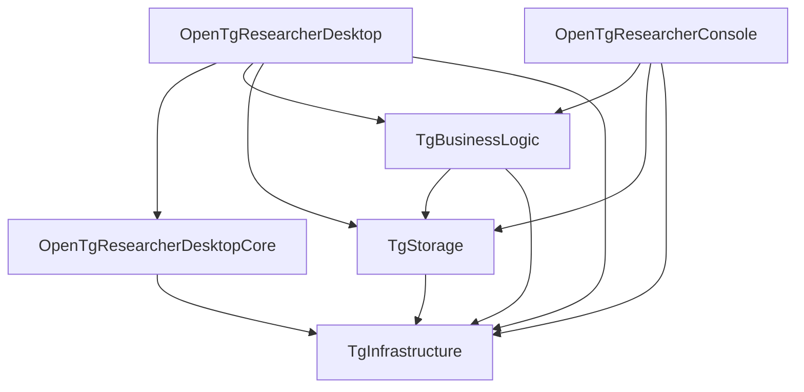
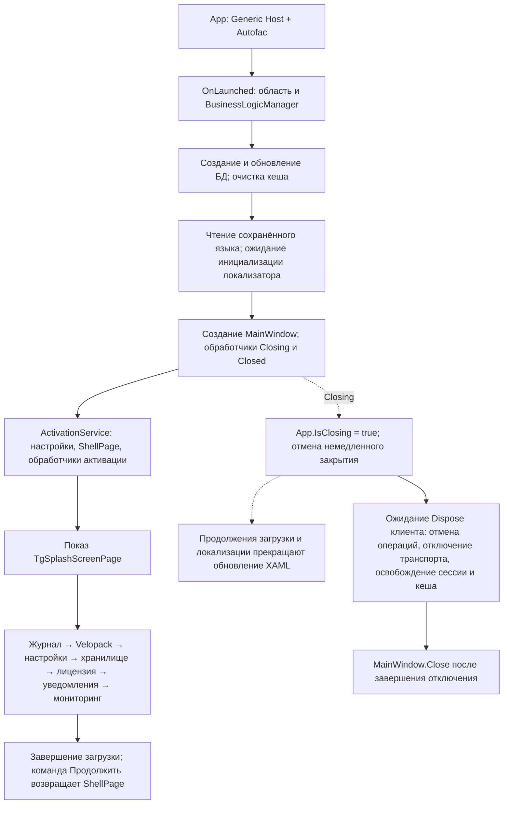
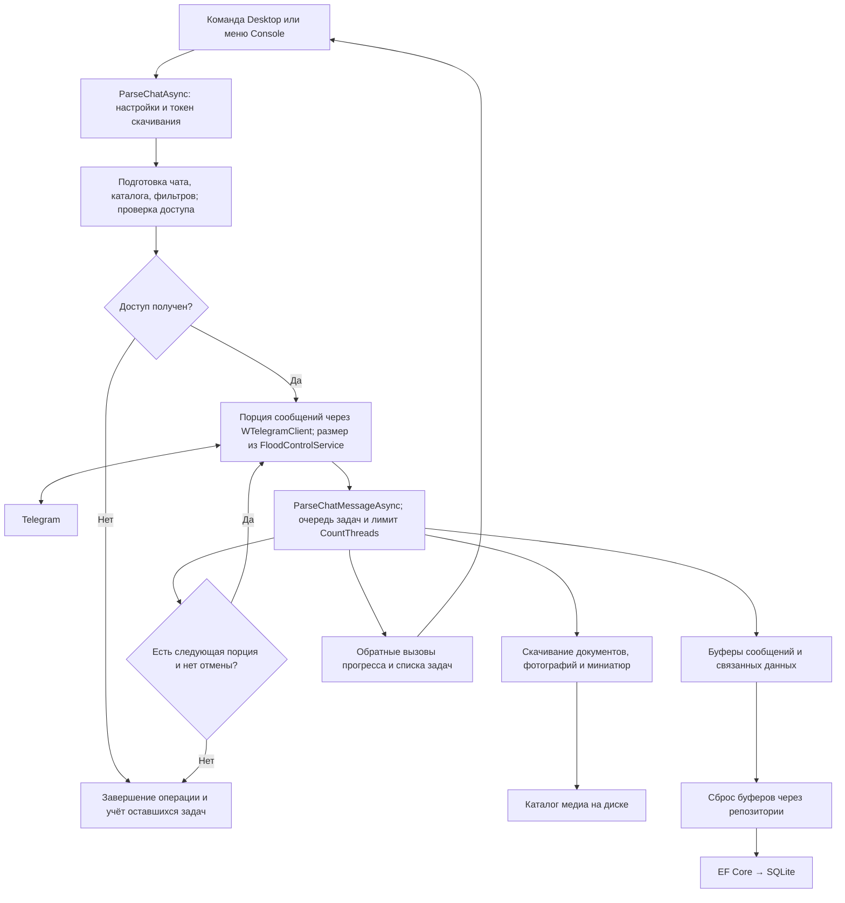
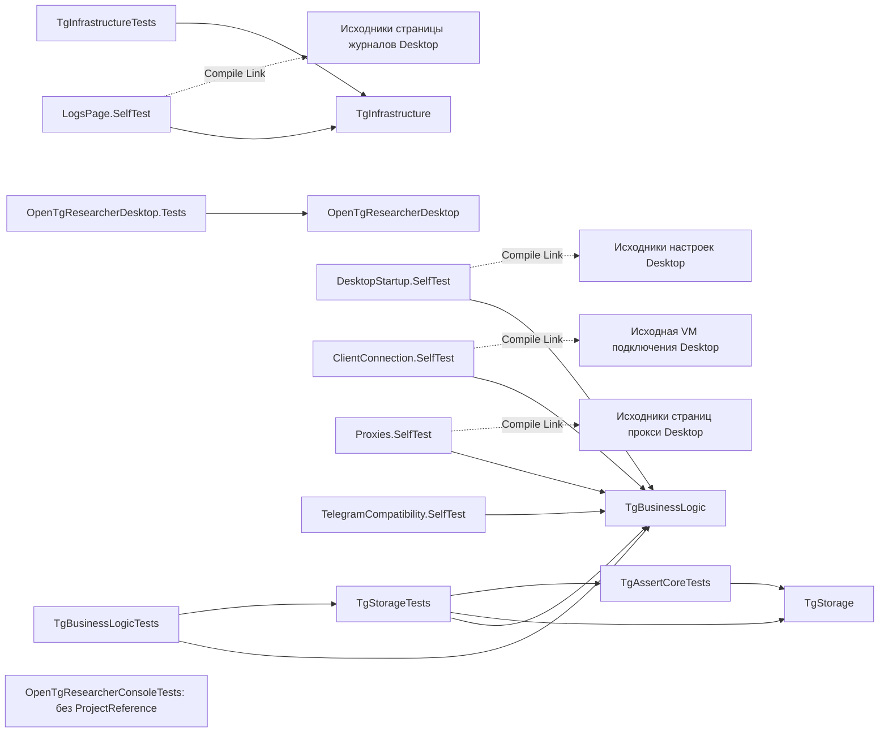

# Архитектура OpenTgResearcher / OpenTgResearcher architecture

[README](README.md) · [Журнал изменений / Changelog](CHANGELOG.md) · [English](#english)

## Область описания

Документ описывает текущий код и все проекты [OpenTgResearcher.slnx](OpenTgResearcher.slnx): приложения, библиотеки, проекты тестов и тестовой поддержки.
Desktop и Console работают в отдельных процессах, используют общие библиотеки и обращаются к Telegram и локальным файлам напрямую.
В решении нет отдельного серверного приложения. Проекта веб-приложения в решении нет.

## Проекты приложений и библиотек

| Проект | Платформа | Ответственность |
| --- | --- | --- |
| [OpenTgResearcherDesktop](Presentation/OpenTgResearcherDesktop/OpenTgResearcherDesktop.csproj) | `net10.0-windows10.0.19041.0`, WinUI 3 | XAML-страницы, модели представления, навигация, настройки, локализация, уведомления и сборка MSIX |
| [OpenTgResearcherConsole](Presentation/OpenTgResearcherConsole/OpenTgResearcherConsole.csproj) | `net10.0`, консоль | Интерактивные меню Spectre.Console, настройка подключения, поиск, скачивание и управление хранилищем |
| [TgBusinessLogic](Core/TgBusinessLogic/TgBusinessLogic.csproj) | `net10.0` | Подключение к Telegram, обработка сообщений и медиа, кеширование, буферы записи, лицензирование, состояния операций и мониторинг оборудования |
| [TgStorage](Core/TgStorage/TgStorage.csproj) | `net10.0` | EF Core и SQLite, контексты, сущности, DTO, репозитории, валидаторы, миграции и общие настройки приложения |
| [TgInfrastructure](Core/TgInfrastructure/TgInfrastructure.csproj) | `net10.0` | Общие контракты, перечисления, DTO, базовые модели представления, локализация и вспомогательные операции с файлами и журналами |
| [OpenTgResearcherDesktopCore](Core/OpenTgResearcherDesktopCore/OpenTgResearcherDesktopCore.csproj) | `net10.0` | Контракт `IFileService` и JSON-файловый сервис настроек Desktop; также содержит шаблонные модели `Sample*` и контракт `ISampleDataService` |

### Ссылки между основными проектами

Сплошная стрелка означает прямую ссылку `ProjectReference` от использующего проекта к используемому.
Повторяющаяся ссылка Desktop → DesktopCore в файле проекта показана один раз.

`TgInfrastructure` не ссылается на другие проекты решения. Контракты распределены между библиотеками:
контракты репозиториев находятся в `TgStorage`, бизнес-сервисов — в `TgBusinessLogic`, сервисов интерфейса — в Desktop.
Это фактическое разделение кода; бизнес-логика зависит от конкретной библиотеки хранения и её DTO.

## Сборка компонентов во время запуска

В [App.xaml.cs](Presentation/OpenTgResearcherDesktop/App.xaml.cs) Desktop создаёт Generic Host с Autofac.
Страницы, модели представления, навигация, настройки и уведомления регистрируются через `IServiceCollection`.
[Модуль сервисов](Presentation/OpenTgResearcherDesktop/Helpers/TgAutofacServiceModule.cs) регистрирует бизнес-сервисы как `SingleInstance`,
а [модуль репозиториев](Presentation/OpenTgResearcherDesktop/Helpers/TgAutofacRepositoryModule.cs) — реализации репозиториев.
Контракт `ITgEfContext` разрешается как `TgEfDesktopContext` с временем жизни `InstancePerLifetimeScope`.

В [Program.Main](Presentation/OpenTgResearcherConsole/Program.cs) Console отдельно создаёт коллекцию сервисов,
получает FusionCache и регистрирует его экземпляр, `TgEfConsoleContext`, репозитории и бизнес-сервисы в Autofac.
После запуска интерактивное меню вызывает общую бизнес-логику.

Оба приложения сохраняют контейнер в [TgGlobalTools](Core/TgStorage/Utils/TgGlobalTools.cs).
[TgBusinessLogicManager](Core/TgBusinessLogic/Services/TgBusinessLogicManager.cs) открывает область контейнера,
получает хранилище, лицензионный сервис, контроль ограничений Telegram, состояние операций и кеш.
По `AppType` он выбирает `TgConnectClientDesktop`, `TgConnectClientConsole` либо другую библиотечную реализацию клиента.
Поэтому зависимости передаются как через конструкторы, так и через доступ к общему контейнеру.

[TgStorageService](Core/TgBusinessLogic/Services/TgStorageService.cs) предоставляет контекст и репозитории бизнес-логике.
[TgEfRepositoryBase](Core/TgStorage/Common/TgEfRepositoryBase.cs) также открывает собственную область контейнера и разрешает свой контекст.
Регистрация пула контекстов сама по себе не означает, что все репозитории используют один контекст или одну общую транзакцию.

### Запуск и закрытие Desktop

Порядок подтверждается [ActivationService](Presentation/OpenTgResearcherDesktop/Services/ActivationService.cs),
[страницей заставки](Presentation/OpenTgResearcherDesktop/Views/TgSplashScreenPage.xaml.cs)
и её [моделью представления](Presentation/OpenTgResearcherDesktop/ViewModels/TgSplashScreenViewModel.cs).
Создание и обновление хранилища вызывается как до показа окна, так и на этапе заставки.
Флаг `App.IsClosing` защищает конкретные продолжения интерфейса; он не является общим токеном отмены всех сервисов.
Обработчик закрытия в [App.Shutdown.cs](Presentation/OpenTgResearcherDesktop/App.Shutdown.cs) ожидает освобождения Telegram-клиента до уничтожения окна. Клиент отвязывает UI-обработчики, завершает транспорт и освобождает файл сессии без выхода из учётной записи. При ошибке завершения окно остаётся открытым, исключение записывается в журнал.
При `ProcessExit` приложение повторно вызывает идемпотентный Dispose клиента без UI-команд, освобождает Host, менеджер и область контейнера, затем закрывает журнал.
[Мониторинг оборудования](Core/TgBusinessLogic/Services/TgHardwareResourceMonitoringService.cs) при освобождении ожидает остановки фоновой задачи.

## Обработка сообщений и медиа

Desktop связывает XAML со свойствами и командами моделей представления через CommunityToolkit.Mvvm.
Общая [базовая модель страницы](Presentation/OpenTgResearcherDesktop/Common/TgPageViewModelBase.cs) хранит настройки скачивания,
состояния и прогресс. Console передаёт настройки из обработчиков меню.
В обоих случаях основная обработка выполняется в [TgConnectClientBase](Core/TgBusinessLogic/Services/TgConnectClientBase.cs).

Схема показывает основной клиентский путь; запись зависит от настроек сохранения и перезаписи.
В [части клиента с буферами](Core/TgBusinessLogic/Services/TgConnectClientBaseFusionCache.cs)
операции `Flush*BufferAsync` передают накопленные DTO репозиториям.
FusionCache используется для результатов запросов и исключения повторной обработки;
[TgBufferCacheHelper](Core/TgBusinessLogic/Helpers/TgBufferCacheHelper.cs) отвечает за накопление и сброс данных.
[LoadStateService](Core/TgBusinessLogic/Services/LoadStateService.cs) хранит признаки занятости, идентификаторы операций и токены отмены.
Обновления Telegram также поступают через обработчики событий в `TgConnectClientBaseEvents.cs`.

Поддержка клиента и бота различается. Console реализует обе ветви `LoginUserAsync`,
а ветвь `UseBot` в `TgConnectClientDesktop.LoginUserAsync` пока пуста.
В основном цикле `ParseChatAsync` вызывается `DownloadMessagesWithClientAsync`; вызов загрузки через бота закомментирован.
Наличие WTelegramBot и вспомогательных методов не означает равное покрытие сценариев клиентом и ботом.

## Данные, настройки и внешние библиотеки

| Компонент | Где реализован и что хранит |
| --- | --- |
| База SQLite | [TgEfContextBase](Core/TgStorage/Common/TgEfContextBase.cs): приложения Telegram, пользователи, участники чатов, документы, фильтры, лицензии, сообщения, связи сообщений, прокси, источники, истории и версии |
| Репозитории | `Core/TgStorage/Repositories`: чтение и сохранение сущностей, преобразование в DTO; контексты Console/Desktop/Test/Memory/Blazor и миграции находятся в `TgStorage` |
| Настройки Desktop | [TgSettingsService](Presentation/OpenTgResearcherDesktop/Services/TgSettingsService.cs) и `FileService`: JSON, по умолчанию `TgLocalSettings.json` в каталоге приложения внутри LocalApplicationData; язык, тема, пути БД/сессии и положение окна |
| Общие настройки | [TgAppSettingsHelper](Core/TgStorage/Helpers/TgAppSettingsHelper.cs): конфигурация приложения, включая XML; путь SQLite выбирается в `GetDataSource` по типу приложения |
| Локализация Desktop | WinUI3Localizer; Package читает `LocalState/Strings`, Unpackaged — `Strings` рядом с исполняемым файлом; язык выбирается до создания окна |
| Журналы | [TgLogUtils](Core/TgInfrastructure/Helpers/TgLogUtils.cs): у Desktop и Console отдельные каталоги `current` внутри LocalApplicationData; Desktop читает журналы через `TgLogsViewModel` |
| Telegram | WTelegramClient, WTelegramBot; настройки подключения и прокси берутся из хранилища; транспорт HTTP CONNECT, SOCKS5 или MTProto задаётся до авторизации, которая использует файл сессии |
| Интерфейс и интеграции | WinUI 3, WinUIEx, CommunityToolkit.Mvvm, уведомления Windows; Spectre.Console в Console; Velopack в обоих приложениях |
| Мониторинг | LibreHardwareMonitor и `TgHardwareResourceMonitoringService`; метрики передаются подписчикам |

Пути к БД, медиа, сессии и настройкам имеют разное назначение; база содержит метаданные, а скачанные медиа записываются в отдельный каталог.
В MSIX-инициализации локализации отсутствующие `Resources.resw` обоих языков копируются из пакета до построения локализатора.
Существующие файлы заменяются при изменении размера; изменение содержимого при том же размере не обнаруживается.
Пути ресурсов описаны в [README](README.md#локализация-при-отладке-desktop).

## Тестовые проекты и границы проверок

Все проекты ниже включены в решение. Ссылки означают их `.csproj`, а не подтверждение прохождения тестов.

| Проект | Назначение и фактические ограничения |
| --- | --- |
| [TgInfrastructureTests](Tests/TgInfrastructureTests/TgInfrastructureTests.csproj) | NUnit: проверки строковых помощников; ссылка на `TgInfrastructure` |
| [TgStorageTests](Tests/TgStorageTests/TgStorageTests.csproj) | NUnit: модель EF, запросы, сохранение, обслуживание SQLite; ссылки на `TgBusinessLogic`, `TgStorage` и `TgAssertCoreTests`; часть проверок использует файловую тестовую БД |
| [TgAssertCoreTests](Tests/TgAssertCoreTests/TgAssertCoreTests.csproj) | Общие тестовые данные `TgDataEnums`; ссылка на `TgStorage`; библиотека поддержки без собственного тестового адаптера |
| [TgBusinessLogicTests](Tests/TgBusinessLogicTests/TgBusinessLogicTests.csproj) | TUnit: проверки мониторинга оборудования; ссылки на `TgBusinessLogic` и `TgStorageTests` |
| [OpenTgResearcherConsoleTests](Tests/OpenTgResearcherConsoleTests/OpenTgResearcherConsoleTests.csproj) | Подготовлен проект NUnit; ссылок на проекты приложения и реализованных тестовых сценариев сейчас нет |
| [OpenTgResearcherDesktop.Tests](Tests/OpenTgResearcherDesktop.Tests.MSTests/OpenTgResearcherDesktop.Tests.csproj) | MSTest с WinUI-хостом и ссылкой на Desktop; текущий тест `Assert.IsTrue(true)` не проверяет поведение приложения |
| [LogsPage.SelfTest](Tests/SelfTests/LogsPage/LogsPage.SelfTest.csproj) | Консольный селфтест: исходные VM, модель и контракт страницы журналов подключены через `Compile Link`; UI заменён заглушками, файловые операции реальные; прямая ссылка на `TgInfrastructure` |
| [DesktopStartup.SelfTest](Tests/SelfTests/DesktopStartup/DesktopStartup.SelfTest.csproj) | Консольный селфтест: исходные служба, модель и контракт настроек через `Compile Link`, заглушки WinUI/локализатора; реальный мониторинг из `TgBusinessLogic` |
| [ClientConnection.SelfTest](Tests/SelfTests/ClientConnection/ClientConnection.SelfTest.csproj) | Консольный селфтест: исходная VM подключения через `Compile Link`, настоящие DTO из `TgBusinessLogic`/`TgStorage`; UI, репозитории и клиент подменены, подключения к Telegram не выполняются |
| [Proxies.SelfTest](Tests/SelfTests/Proxies/Proxies.SelfTest.csproj) | Исходные VM списка и карточки прокси, общий обработчик подтверждений через `Compile Link`; настоящие репозиторий и SQLite в памяти, HTTP CONNECT и SOCKS5 на loopback, настройка MTProto без Telegram; явный режим `--live` проверяет Desktop-подключение без прокси и с первой записью, используя БД только для чтения и копии сессии |
| [TelegramCompatibility.SelfTest](Tests/SelfTests/TelegramCompatibility/TelegramCompatibility.SelfTest.csproj) | Совместимость с обновлёнными API WTelegram и Telegram.Bot: сохранение ID истории настоящим сервисом и репозиторием в SQLite в памяти, три состояния разрешения управления темами; без Telegram |

Селфтесты с заглушками проверяют поведение подключённых исходников, но не воспроизводят полностью отрисовку и жизненный цикл WinUI.
Дополнительные скрипты проверки:

- [Test-DesktopArchitecture.ps1](Tests/SelfTests/Test-DesktopArchitecture.ps1) проверяет выбор архитектуры Windows App SDK в конфигурациях решения, не компилируя приложение.
- [Test-RebuildOutputs.ps1](Tests/SelfTests/Test-RebuildOutputs.ps1) воспроизводит отложенный запуск цели очистки после Rebuild на отдельном MSBuild-проекте и проверяет сохранность результата сборки.
- [Test-DesktopShutdown.ps1](Tests/SelfTests/Test-DesktopShutdown.ps1) запускает установленный Package под CDB, закрывает окно и анализирует завершение; требует Windows SDK Debuggers и полного имени установленного пакета.

В решении `Any CPU` для Desktop и его MSTest-проекта сопоставлен с `x64`. Приложение включает Windows App SDK в режиме `WindowsAppSDKSelfContained`; библиотека тестов использует SDK приложения и не включает его самостоятельно.
Скрипт проверки архитектуры относится к платформе сборки; он не проверяет описанные здесь связи компонентов.
Исходники Console включают Dockerfile с терминалом `ttyd`; Docker не является отдельным C#-проектом решения.
