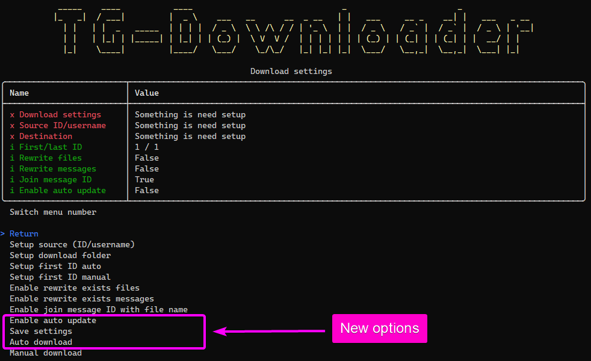

# Журнал изменений

[README](README.md) · [Архитектура](ARCHITECTURE.md) · [Список задач](TODO.md) · [Руководства](Docs/GUIDES-RUS.md) · [Релизы](RELEASES.md) · [Скриншоты](SCREENSHOTS.md)

## [0.8.020]
### Добавлено
- Добавление архитектуры приложения: все проекты, зависимости, блок-схемы запуска и обработки сообщений, границы тестовых проверок
- Добавление полного управления прокси в Desktop: создание, редактирование, проверка полей, перезагрузка, очистка формы, сортировка, удаление выбранной записи и всех записей с подтверждением
- Добавление селфтестов подключения, управления прокси, совместимости API Telegram, завершения клиента и сохранности результатов Rebuild
- Добавление регрессионной проверки IL точек входа Desktop и Console: ранний и единственный вызов Velopack, сохранение запуска приложений и STA в Desktop
### Изменено
- Изменение целевой платформы всех 17 проектов на .NET 10, обновление CI, Docker и 18 профилей публикации
- Обновление NuGet-пакетов и адаптация к новым API WTelegram, Telegram.Bot, NUnit, TUnit и Windows App SDK
- Изменение завершения Desktop: окно ожидает отключения Telegram и освобождения сессии; авторизация сохраняется для следующего запуска
### Исправлено
- Исправление копирования ресурсов локализации MSIX, добавление регрессионных селфтестов
- Исправление формы подключения клиента: выбор прокси, отмена и ожидание действий, состояние подключения и обработка ошибок; добавление 16 селфтестов
- Исправление настройки HTTP CONNECT, SOCKS5 и MTProto до авторизации; восстановление штатного TCP-транспорта при отключении прокси и устранение NullReferenceException
- Исправление сохранения UID прокси, отображения ошибок ввода и сброса ссылок профилей только на удаляемые записи; откат удаления при ошибке SQLite
- Исправление обработки RecentStory.max_id, Peer.ID, перегрузки загрузки исходного документа, синхронного InputUser и nullable-разрешения управления темами
- Исправление ожидания асинхронных NUnit-проверок, обработчика метрик TUnit и конфигурации Windows App SDK библиотеки Desktop-тестов
- Исправление удаления уже собранных DLL при повторном запросе очистки во время Rebuild
- Исправление раннего возврата Dispose клиента и обращения к закрытому интерфейсу при завершении активного подключения Telegram
- Исправление запуска Velopack в Desktop и Console: обработка установщика выполняется в начале синхронного Main до интерфейса, DI и хранилища; приветствие первой установки сохранено
### Удалено
- Удаление async void при освобождении клиента, запуска UI-команды отключения из ProcessExit и флага очистки, приводившего к удалению результатов Rebuild
- Удаление поздних вызовов Velopack из загрузки заставки Desktop и инициализации Console
### Перенесено
- Перенос завершённых задач по .NET 10, совместимости NuGet, управлению прокси, настройке транспорта и отключению Telegram в раздел закрытых задач TODO
- Перенос задачи раннего запуска Velopack в закрытые после селфтестов, проверки упаковки обоих приложений и подтверждения запуска пользователем

## [0.7.840]
### Добавлено
- Подробности прогресса загрузки, счётчики задач сообщений и медиа, список активных задач в `OpenTgResearcherDesktop`
- Селфтест закрытия Desktop и инструкции по локализации при отладке в README на двух языках
- Селфтесты сохранённого языка заставки и завершения фонового мониторинга
### Исправлено
- Восстановление идентификатора Telegram-чата при нулевом идентификаторе в DTO хранилища
- Исправлено закрытие Desktop во время запуска: продолжения загрузки больше не обращаются к XAML после закрытия окна
- Исправление чтения и удаления журналов Desktop, добавление селфтестов
- Сохранённый язык применяется до первого отображения заставки
- Исправлены обновление локализации после закрытия окна и освобождение ресурсов до остановки мониторинга
### Изменено
- Обновление `.gitignore`
- Переработаны учёт и завершение задач загрузки; удалён `IsDownload` из DTO хранилища
- Решение переведено в формат SLNX, обновлено восстановление зависимостей в CI
- Перенос журнала изменений
- Перенос шаблона проблем
- Перенос статистики скачиваний
- Удаление программы поощрения за обнаружение ошибок
- Все тестовые проекты включены в решение
- Перенос скриншотов

## [0.7.800]
### Исправлено
- Исправление создания прокси в `OpenTgResearcherConsole`
- Исправление страницы `Подключение клиента` в `OpenTgResearcherDesktop`
- Исправление создания чата `Сохранённые сообщения` в `OpenTgResearcherDesktop`
- Исправление инициализации хранилища в `OpenTgResearcherDesktop`
- Исправление смены языка в `OpenTgResearcherDesktop`
- Исправление сохранения данных в хранилище
### Изменено
- Обновление страницы `Обновление` в `OpenTgResearcherDesktop`
### Добавлено
- Добавление удаления чата на странице `Чаты` в `OpenTgResearcherDesktop`

## [0.7.650]
### Исправлено
- Оптимизация колонок таблиц в `OpenTgResearcherDesktop`
- Исправление операции отмены парсинга Телеграм
- Исправление автоподключения к Telegram при старте в `OpenTgResearcherConsole`
- Исправление отображения Flood Control при парсинге чата в `OpenTgResearcherConsole`
- Исправление некоторых ошибок в основной логике парсинга Telegram
- Исправление страницы `Логи` в `OpenTgResearcherDesktop`
- Исправление страницы `Подключение клиента` в `OpenTgResearcherDesktop`
### Изменено
- Обновление NuGet пакетов
- Оптимизация `TgStorage`
- Удаление требований лицензирования
- Обновление таблицы `Чаты` в `TgStorage`
- Обновление страницы `Чат` в `OpenTgResearcherDesktop`
### Добавлено
- Добавление таблицы `Пользователи чатов` в `TgStorage`
- Поиск без учета регистра на странице `Чаты` в `OpenTgResearcherDesktop`
- Добавление строк состояния `Хранилища` и `Онлайн` в `OpenTgResearcherDesktop`
- Добавление останова парсинга на странице `Чаты` в `OpenTgResearcherDesktop`
- Добавление страницы `Сохранённые Сообщения` в `OpenTgResearcherDesktop`
- Добавление страницы `Редактирование прокси` в `OpenTgResearcherDesktop`

## [0.7.400]
### Исправлено
- Исправление ГитХаб workflow
- Исправление багов парсинга медиа комментариев
- Исправление загрузки сообщений на странице `Чат` в `OpenTgResearcherDesktop`
- Исправление создания имен файлов
- Исправление останова парсинга чата
- Исправление сохранения первого ID чата в момент останова парсинга
- Исправление подключения к ТГ и отключения для верхнего меню в `OpenTgResearcherDesktop`
- Исправление опции скрытия чувствительных данных
- Оптимизация страниц в `OpenTgResearcherDesktop`
### Изменено
- Обновление NuGet пакетов
- Обновлёние проекта тестов `TgStorageTests`
- Обновление страницы `Содержимое чата` в `OpenTgResearcherDesktop`
- Обновление страницы `Статистика чата` в `OpenTgResearcherDesktop`
- Обновление анимации загрузки программы
- Обновление кнопки копирования в `OpenTgResearcherDesktop`
- Обновление страницы `Логи` в `OpenTgResearcherDesktop`
- Обновление страницы `Детали пользователя` в `OpenTgResearcherDesktop`
- Обновление страницы `Чаты` в `OpenTgResearcherDesktop`
- Обновление страницы `Пользователи` в `OpenTgResearcherDesktop`
- Обновление страницы `Хранилище` в `OpenTgResearcherDesktop`
- Обновление страницы `Оборудование` в `OpenTgResearcherDesktop`
- Обновление вкладки `Участники` на странице `Чат` в `OpenTgResearcherDesktop`
- Обновление таблицы `Сообщения` в `TgStorage`
### Добавлено
- Добавление сервиса мониторинга аппаратных ресурсов
- Добавление проекта тестов `TgBusinessLogicTests`
- Добавление описания добавления лицензии в `OpenTgResearcherDesktop`
- Добавление прогресса скачивания медиа файлов на странице `Содержимое чата` в `OpenTgResearcherDesktop`
- Добавление скачивания обложек для медиа файлов
- Добавление запроса комьюнити лицензии
- Добавление отображения списка чатов пользователя в `OpenTgResearcherDesktop`
- Добавление отображения списка сообщений чата пользователя в `OpenTgResearcherDesktop`

## [0.7.140]
### Исправлено
- Исправление багов парсинга чатов
- Исправление багов при создании пустого хранилища, которое создается при загрузке `OpenTgResearcherDesktop`
### Изменено
- Открыт доступ к боту в `OpenTgResearcherConsole` для бесплатной лицензии
- Обновлены NuGet пакеты
- Обновлены страницы `Чаты` и `Чат` в `OpenTgResearcherDesktop`
- Обновлена таблица `Чаты` в `TgStorage`
- Обновлена таблица `Сообщения` в `TgStorage`
- Обновлена библиотека `TgStorage`
- Обновлена библиотека `TgBusinessLogic`
- Улучшения производительности и стабильности в `OpenTgResearcherDesktop`
- Обновление страницы `Чаты` в `OpenTgResearcherDesktop`
- Обновлён парсинг чатов в `OpenTgResearcherConsole`
### Добавлено
- Добавлено поле `Подписка` при сканировании чатов
- Добавлено поле `Подписка` на страницу `Чаты`
- Добавлена фильтрация чатов по полю `Подписка` в `OpenTgResearcherDesktop`
- Оптимизация запросов к базе данных на странице `Чаты` в `OpenTgResearcherDesktop`
- Добавлена настройка фильтрации на странице `Чаты` в `OpenTgResearcherDesktop`
- Добавлена таблица `Отношения сообщений` в `TgStorage`
- Добавлено чтение комментариев при парсинге сообщений чата
- Добавлен индикатор `Защита от флуда` в `OpenTgResearcherDesktop`
- Добавлен обратный отсчет для защиты от флуда в `OpenTgResearcherDesktop`
- Добавлен `Подарочный` тип лицензии

## [0.6.860]
### Исправлено
- Исправлено онлайн обновление чатов в `OpenTgResearcherDesktop`
- Исправлена страница чатов в `OpenTgResearcherDesktop`
- Исправлена страница подключения клиента в `OpenTgResearcherDesktop`
- Исправлена страница настроек в `OpenTgResearcherDesktop`
- Исправлено подключение клиента
- Исправлена страница логов в `OpenTgResearcherDesktop`
- Исправлены загрузка и сохранение настроек в `OpenTgResearcherDesktop`
- Исправлена загрузка медиа и парсинг сообщений для каналов
### Изменено
- Обновлена таблица сообщений в TgStorage
- Обновлена главная страница в `OpenTgResearcherDesktop`
- Обновлён просмотр деталей чата в `OpenTgResearcherConsole`
- Обновлена страница просмотра деталей чата в `OpenTgResearcherDesktop`
- Обновлена страница просмотра чатов в `OpenTgResearcherDesktop`
- Обновлена документация
- Оптимизировано обращение к хранилищу
- Обновлена страница контактов в `OpenTgResearcherDesktop`
- Обновлена `README`
- Стабилизация и оптимизация `OpenTgResearcherDesktop`
### Добавлено
- Добавлена проверка сообщений на удалённые при повторном скнировании чата
- Добавлено отображение ссылки на сообщение в `OpenTgResearcherDesktop`
- Добавлен просмотр деталей чата в `OpenTgResearcherDesktop`
- Добавлен просмотр участников чата в `OpenTgResearcherDesktop`
- Добавлен просмотр статистики чата в `OpenTgResearcherDesktop`
- Добавлен просмотр статистики содержимого в `OpenTgResearcherDesktop`
- Добавлена таблица пользователей в хранилище
- Добавлена страница пользователей в `OpenTgResearcherDesktop`
- Добавлено сохранение пользователей чата в `OpenTgResearcherDesktop`
- Добавлены сообщения на страницу деталей пользователя в `OpenTgResearcherDesktop`
- Добавлена вкладка `Детали чата` на странице чата в `OpenTgResearcherDesktop`
- Добавлена вкладка «Участники чата» на странице чата в `OpenTgResearcherDesktop`
- Добавлена вкладка «Статистика чата» на странице чата в `OpenTgResearcherDesktop`
- Добавлена вкладка «Содержимое» на странице чата в `OpenTgResearcherDesktop`

## [0.6.600]
### Исправлено
- Исправлено обновление хранилища в OpenTgResearcherDesktop
### Изменено
- Обновлены NuGet пакеты
- Увеличен лимит на количество потоков скачивания для пользователя с бесплатной лицензией
- Оптимизирована загрузка страницы чатов в OpenTgResearcherDesktop
- Обновлена документация
- Обновлена таблица чатов в TgStorage
### Добавлено
- Добавлено копирование сообщений на странице чата в OpenTgResearcherDesktop
- Добавлена ленивая загрузка и статистика данных на странице чатов в OpenTgResearcherDesktop
- Добавлено скрытие конфиденциальных данных на странице подключения клиента в OpenTgResearcherDesktop
- Добавлено скрытие конфиденциальных данных на странице деталей чата в OpenTgResearcherDesktop
- Добавлена проверка чата на ограничение сохранения содержимого
- Добавлен просмотр скачанных изображений чата в OpenTgResearcherDesktop
- Добавлено копирование сообщений чата в OpenTgResearcherDesktop

## [0.6.550]
### Исправлено
- Исправлена настройка клиента и бота в OpenTgResearcherConsole
### Добавлено
- Добавлена страница хранилища в OpenTgResearcherDesktop
- Добавлена страница настройки хранилища в OpenTgResearcherDesktop
- Добавлена страница расширенных настроек хранилища в OpenTgResearcherDesktop

## [0.6.500]
### Изменено
- Расширение информации о подключении бота в OpenTgResearcherConsole
- Расширение информации о подключении клиента в OpenTgResearcherConsole
- Обновлено логирование в файл
### Добавлено
- Добавлен поиск инфо о чате в OpenTgResearcherConsole
- Добавлен поиск инфо о пользователе в OpenTgResearcherConsole
- Добавлен мониторинг чатов в OpenTgResearcherConsole
- Добавлены настройки мониторинга чатов в OpenTgResearcherConsole
- Добавлено логирование приложения OpenTgResearcherConsole в файл
- Добавлен поиск ключевых слов в чатах в OpenTgResearcherConsole

## [0.6.300]
### Изменено
- Повышение эффективности высвобождения неуправляемых ресурсов
- Обновлено меню в OpenTgResearcherConsole
- Оптимизация просмотра таблиц в OpenTgResearcherConsole
- Обновлена таблица приложений в TgStorage
### Добавлено
- Добавлено меню подключения бота в OpenTgResearcherConsole
- Добавлена проверка нескольких экземпляров приложения в OpenTgResearcherConsole

## [0.6.240]
### Исправлено
- Исправление загрузки и сохранения настроек в OpenTgResearcherDesktop
### Изменено
- Обновлено меню в OpenTgResearcherConsole
- Обновлён просмотр лицензии
- Обновлены NuGet пакеты
- Обновлён Velopack инсталлятор
- Обновлена заставка и добавлена анимация в OpenTgResearcherDesktop
- Изменена загрузка инсталлера в OpenTgResearcherDesktop
- Улучшение ведения журнала и управления состоянием окна в OpenTgResearcherDesktop
- Обновление Докер версии OpenTgResearcherConsole
### Добавлено
- Добавлены методы запоминания размера и положения окна между сессиями в OpenTgResearcherDesktop
- Добавлено удаление лицензии
- Добавлен запрос тестовой лицензии
- Увеличен лимит на количество потоков скачивания для пользователя с платной или тестовой лицензией
- Добавлена обработка чувствительных полей в OpenTgResearcherDesktop

## [0.6.140]
### Исправлено
- Исправлено отображение прогресса для чатов в OpenTgResearcherDesktop
- Исправлено подключение к серверу
### Изменено
- Обновлён поиск в чатах OpenTgResearcherDesktop
### Добавлено
- Добавлена опция создания подкаталогов для чатов в TgDownloaderConsole
- Добавлена опция создания подкаталогов для чатов в OpenTgResearcherDesktop
- Добавлена опция именования медиа файлов по сообщению для чатов в TgDownloaderConsole
- Добавлена опция именования медиа файлов по сообщению для чатов в OpenTgResearcherDesktop
- Добавлено подключение и отключение клиента из заголовка OpenTgResearcherDesktop
- Добавлены ссылки в TgDownloaderConsole

## [0.6.080]
### Исправлено
- Исправлены представления страниц в OpenTgResearcherDesktop
- Исправлена загрузка портативной версии OpenTgResearcherDesktop
### Изменено
- Обновлена загрузка страниц в OpenTgResearcherDesktop
- Обновлена проверка обновлений в TgDownloaderConsole
### Добавлено
- Добавлена страница логов в OpenTgResearcherDesktop
- Добавлен прогресс загрузки приложения OpenTgResearcherDesktop

## [0.6.040]
### Исправлено
- Исправлены ссылки в документации
- Исправлены баги в TgStorage
- Исправлены баги в TgDownloaderConsole
### Изменено
- Обновлены GitHub workflows actions
- Обновлена таблица приложений в TgStorage
- Обновлена таблица сообщений в TgStorage
- Обновлена таблица документов в TgStorage
- Обновлена таблица источников в TgStorage
### Добавлено
- Добавлена опция включения/отключения сохранения сообщений для чата в TgDownloaderConsole
- Добавлено чтение доступа пользователя к чату через поиск в TgDownloaderConsole
- Добавлена страница лицензии для TgDownloaderDesktop
- Добавлено состояние подключения для заголовка приложения TgDownloaderDesktop

## [0.5.450]
### Изменено
- Обновлены NuGet пакеты
- Исправлены некоторые исключения в TgDownloaderConsole

## [0.5.440]
### Исправлено
- Исправлены проверки файлов для TgDownloaderDesktop
### Изменено
- Обновлена страница подключения в TgDownloaderDesktop
- Обновлён образ TgDownloaderConsole Docker
### Добавлено
- Добавлен Velopack инсталлятор для TgDownloaderDesktop
- Добавлен фильтр чатов для TgDownloaderDesktop
- Добавлена страница подробностей чата для TgDownloaderDesktop
- Добавлен запуск скачивания чата на странице подробностей для TgDownloaderDesktop
- Добавлен останов скачивания чата на странице подробностей для TgDownloaderDesktop

## [0.5.430]
### Исправлено
- Исправления для TgStorage
- Исправления для TgDownloaderConsole
### Изменено
- Обновлена таблица приложений в TgStorage
- Обновлены NuGet пакеты
- Обновлена версия .NET с 8.0 на 9.0

## [0.5.410]
### Исправлено
- Исправлена проверка подключения к чату для TgDownloaderConsole
### Добавлено
- Добавлен Velopack инсталлятор для TgDownloaderConsole
- Добавлено меню обновления для TgDownloaderConsole

## [0.5.330]
### Исправлено
- Исправлена страница подключения для TgDownloaderDesktop
### Добавлено
- Добавлена страница редактирования контакта для TgDownloaderDesktop

## [0.5.320]
### Исправлено
- Устранена ошибка `Последовательность содержит более одного элемента` для TgDownloaderConsole
- Устранена ошибка `Access to the path ...\TgDownloader.xml is denied` при подключении к серверу для TgDownloaderDesktop
### Изменено
- Обновлена страница источников для TgDownloaderDesktop
- Обновлена страница контактов для TgDownloaderDesktop
- Обновлена страница сторис для TgDownloaderDesktop
- Обновлена страница фильтров для TgDownloaderDesktop
### Добавлено
- Поиск источника по полю UserName для TgDownloaderConsole
- Обновлена страница прокси для TgDownloaderDesktop

## [0.5.300]
### Исправлено
- Подключение к Телеграм серверу для TgDownloaderDesktop
### Изменено
- Обновлена домашняя страница для TgDownloaderDesktop
- Обновлена страница источников для TgDownloaderConsole
- Обновлена страница контактов для TgDownloaderConsole
- Обновлена страница сторис для TgDownloaderConsole
- Обновлена таблица источников в хранилище
- Обновлены таблицы хранилища для случаев асинхронной записи
### Добавлено
- Добавлена страница контактов для TgDownloaderDesktop
- Добавлена страница фильтров для TgDownloaderDesktop
- Добавлена страница сторис для TgDownloaderDesktop
- Добавлено чтение контактов на странице контактов для TgDownloaderDesktop

## [0.5.250]
### Изменено
- Обновлена страница настроек для TgDownloaderDesktop
### Добавлено
- Добавлена таблица контактов в хранилище
- Добавлена таблица сторис в хранилище
- Добавлен поиск и просмотр контактов для TgDownloaderConsole
- Добавлен поиск и просмотр сторис для TgDownloaderConsole
- Добавлена страница источников для TgDownloaderDesktop
- Добавлен скрипт PowerShell установки TgDownloaderDesktop

## [0.5.230]
### Исправлено
- Исправлено отображение спец символов в имени каталога для скачивания для TgDownloaderConsole
- Исправлено отображение по-умолчанию ID = 1 для TgDownloaderConsole
- Исправлено сканирование источников для TgDownloaderConsole
### Изменено
- Количество потоков скачивания по-умолчанию (с 1 до 5) для TgDownloaderConsole
- Обновлены NuGet пакеты
- Улучшена стабильность работы для TgDownloaderConsole
- Улучшена стабильность работы для TgDownloaderDesktop
### Добавлено
- Добавлена языковая локализация для TgDownloaderDesktop
- Страница подключения для TgDownloaderDesktop
- Бесплатная лицензия для TgDownloaderDesktop

## [0.5.180]
### Исправлено
- Созданы сущности EF Core
- Выполнение тестов
- GitHub workflows actions
- Исправлено сохранение имен файлов с неподдерживаемыми символами под Windows / Linux / MacOS
- Исправлено перемещение существующих файлов в текущем каталоге
- Исправлено создание хранилища TgStorage
## Изменено
- Использование EF Core вместо DevExpress XPO
## Добавлено
- Добавлена многопоточность для TgDownloaderConsole
- Добавлено приложение TgDownloaderDesktop (WinUI)
- Добавлено приложение TgDownloaderDesktop.Core (WinUI)
- Добавлено приложение TgDownloaderDesktop.Tests.MSTest (WinUI)
- Добавлена страница настроек для TgDownloaderDesktop

## [0.4.150]
### Добавлены приложения
- Добавлена библиотека TgEfCore (библиотека доступа к хранилищу)
- Добавлены тесты TgEfCoreTests (тесты библиотеки доступа к хранилищу)
- Добавлен Docker-контейнер TgDownloaderConsole
### Добавлено в TgEfCore
- Поддержка таблицы приложений
- Поддержка таблицы документов
- Поддержка таблицы фильтров
- Поддержка таблицы сообщений
- Поддержка таблицы прокси
- Поддержка таблицы источников
- Поддержка таблицы версий
### Добавлено в TgDownloaderConsole
- Поддержка Docker

## [0.3.110]
### Добавлено в TgDownloaderConsole
- Прогресс скачивания текущего файла
- Пометить все сообщения как прочитанные
### Добавлено в TgDownloaderWinDesktop
- Прогресс скачивания текущего файла
- Пометить все сообщения как прочитанные
### Изменено в TgDownloaderWinDesktop
- Интерфейс

## [0.3.20]
### Добавлено
- Руководство по настройке докер версии

## [0.3.10]
### Изменено
- Обновлена версия NET 8
- Обновлена версия NuGet пакетов
### Добавлено в TgDownloaderWinDesktop
- Копирование полей в источнике

## [0.2.580]
### Добавлено
- [Шаблон проблемы](ISSUE-TEMPLATE.md)

## [0.2.570]
### Добавлено в TgDownloaderWinDesktop
- Авто обновление прогресса при скачивании на страница источника
### Исправлено в TgDownloaderConsole
- Скачивание источника, который ещё не входит в таблицу источников

## [0.2.550]
### Исправлено в TgDownloaderConsole
- Чтение номера последнего сообщения
### Исправлено в TgDownloaderWinDesktop
- Очистка таблицы приложений
- Сообщение при подключении клиента к серверу Телеграм
- Корректная загрузка пустых источников при первой загрузке
- Чтение источников из Телеграм
- Сканирование каналов/диалогов
### Добавлено
- Руководство по настройке десктоп версии
- Сканирование каналов/диалогов

## [0.2.490]
### Исправлено
- Создание нового хранилища

## [0.2.480]
### Добавлено в TgDownloaderWinDesktop
- Добавление нового прокси
- Редактирование прокси
- Возврат в раздел прокси
- Возврат в раздел источников
### Исправлено в TgDownloaderWinDesktop
- Удаление прокси

## [0.2.460]
### Исправлено в TgDownloaderConsole
- Рефакторинг и тесты
### Добавлено в TgDownloaderConsole
- Прогресс скачивания в названия консоли
### Исправлено в TgDownloaderWinDesktop
- Рефакторинг и тесты
### Добавлено в TgDownloaderWinDesktop
- Подключение клиента через прокси
- Отключение клиента от прокси
- Сохранение настроек
- Переход на страницу настроек источника
### Исправлено в TgStorage
- Исправлены методы репозиториев

## [0.2.300]
### Исправлено в TgDownloaderConsole
- Исправлены ошибки с файлом TgDownloader.session
### Исправлено в тестах
- Исправлены ошибки в тестах
### Добавлено в TgDownloaderWinDesktop
- Редактирование настроек приложения
- Просмотр/редактирование настроек клиента
- Клиент
    - Подключение/отключение
    - Скрыть пароль
    - Просмотр состояния и исключений
- Просмотр прокси-серверов
- Просмотр источников и загрузка
    - Проверка готовности клиента
    - Загрузка из хранилища
    - Загрузка из Telegram
    - Очистить представление
    - Просмотр состояния и исключений
    - Загрузить медиа

## [0.2.240]
### Исправлено в TgDownloaderConsole
- Восстановление ApiId когда был удалён файл сессии
- Автонастройка автообновления после настройки каталога скачивания
### Добавлено
- Проект TgDownloaderWinDesktop (WPF UI - Fluent Navigation (MVVM | DI))
### Добавлено в TgDownloaderConsole
- Меню Дополнительно -> Автопросмотр событий
- Автообновление ID последнего сообщения в меню Дополнительно -> Автопросмотр событий

## [0.2.160]
### Изменено
- Версия хранилища 18
- Просмотр источников в хранилище
- Сканировать мои чаты / Сканировать мои диалоги
- Структура проектов и свойства
### Добавлено
- Поле дата время для таблицы источников
- Действия GitHub

## [0.2.130]
### Изменено
- Новый ORM-фреймворк для хранилища SQLite (DevExpress XPO)
- Версия хранилища 17
### Добавлено
- Сканирование каналов/диалогов с возможностью сохранения как источников
- Просмотр источников в хранилище с возможностью перехода в меню скачивания
- Сохранение сообщений
### Устарело
- ПО v0.2.xxx имеет новый формат хранилища, сохраните предыдущий файл, он будет перезаписан

## [0.1.730]
### Добавлено
- Настройки фильтров
- Создание резервного хранилища

## [0.1.630]
### Исправлено
- Прокси для загрузки
- Перезапись файлов нулевого размера
### Добавлено
- Настройка приложения для пути к файлу сессии
- Настройка приложения для пути к файлу хранилища
- Настройка приложения для использования прокси
- Автоматическое создание каталога для ручного скачивания
- Автоматическое создание каталогов для авто скачивания
- Таблица версий хранилища

## [0.1.500]
### Добавлено
- Прокси для загрузки
- Сообщения об исключениях клиента и прокси

## [0.1.430]
### Добавлено
- Авто скачивание
### Скриншоты

## [0.1.390]
### Добавлено
- Установка времени и даты файла
- Сканирование вложенных каталогов на наличие загруженных файлов для перемещения в корневой каталог
### Изменено
- Объединение настроек идентификатора источника и имени пользователя

## [0.1.360]
### Исправлено
- Ввод идентификатора источника
- Автосохранение и автозагрузка настроек для загрузки канала/группы

## [0.1.350]
### Добавлено
- Автовычисление идентификатора стартового сообщения
- Ручная установка идентификатора стартового сообщения
- Автопереименование скачанных файлов, если включена опция добавления идентификатора к имени файла
- Автосохранение и автозагрузка каталога для скачивания канала/группы
### Изменено
- Метод переключения для выбора булевого ответа
### Исправлено
- Перезапись сообщений

## [0.1.310]
### Добавлено
- Идентификатор сообщения в настройках загрузки
- Сохранение настроек приложения в файл xml
### Изменено
- Настройка загрузок по идентификатору канала/группы

## [0.1.250]
### Добавлено
- Настройки хранилища
- Пропускать загруженные файлы
- Автосохранение информации о подключении в локальном файле хранилища
### Изменено
- Настройки клиента
- Настройки загрузки

## [0.1.180]
### Добавлено
- Информационное подменю
- Прогресс загрузки
### Изменено
- Меню клиента
- Меню загрузки
- Сборка информации
- Обработка исключений

## [0.1.150]
### Добавлено
- Первый релиз
- Меню
- Журнал
- Клиент
- Загрузка

## [0.1.100]
### Добавлен
- Английская локализация
- Тесты

## [0.1.020]
### Добавлен
- Файлы базы Git
- Проект TgDownloaderConsole
