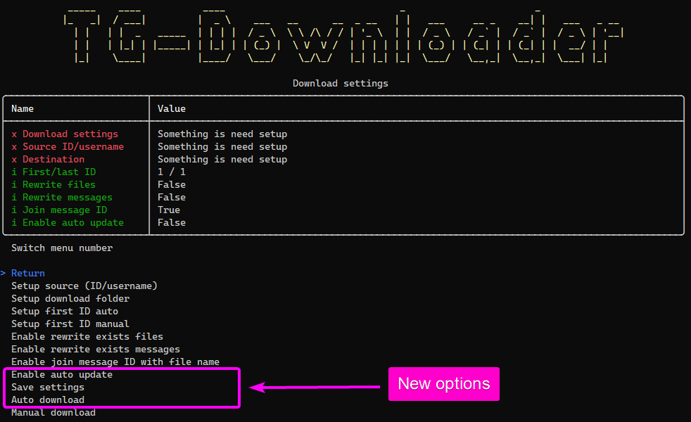

# Журнал изменений

[README](README.md) · [Разработчикам](README-DEV.md) · [Архитектура](ARCHITECTURE.md) · [Список задач](TODO.md) · [Руководства](Docs/GUIDES-RUS.md) · [Релизы](RELEASES.md) · [Скриншоты](SCREENSHOTS.md)

## [0.8.600]
### Добавлено
- Добавление страницы «Программа» с настройками языка, автозапуска, системной или выбранной темы и цвета акцента; кнопка сохранения закреплена в заголовке и доступна при прокрутке
- Добавление автоматического открытия параметров после заставки при первом запуске установленной версии и после смены версии; после сохранения настроек повторные запуски той же версии не открывают страницу автоматически
- Добавление автозапуска установленного Desktop при входе в Windows для текущего пользователя с управлением через Диспетчер задач; запуск через загрузчик Velopack сохраняет работоспособность после обновления
- Добавление выбора цвета акцента через палитру или поле #RRGGBB, применения системного акцента и отслеживания изменений системной палитры
- Добавление сохраняемого параметра включения предварительных выпусков в проверку обновлений из верхней панели
- Добавление отдельного подтверждения найденного предварительного выпуска с номером версии и пояснением о возможных ошибках; отказ отменяет скачивание и перезапуск
- Добавление русских и английских подписей параметров, сообщений сохранения и предупреждения о предварительном выпуске
- Добавление выбора языка и темы на заставке и изменение значка языка
### Изменено
- Изменение применения обновлений: после успешного скачивания программа останавливает парсинг всех чатов, освобождает сессию Telegram и запускает применение пакета с автоматическим перезапуском
- Изменение сохранения параметров программы: прежние настройки сохраняются между версиями, язык и тема применяются без записи черновиков путей к БД и сессии; ошибки применения отображаются на странице и записываются в журнал
- Изменение пункта бокового меню «Обновление» на «Программа»; боковое меню и верхняя панель используют одинаковый контурный значок обновлений с поддержкой светлой и тёмной темы
- Изменение оформления заставки и анимации кнопки продолжения
- Объединение обновлений и компактных настроек приложения
### Исправлено
- Исправление определения предварительного выпуска: учитываются суффикс версии и флаг GitHub, включая обычные числовые версии; стабильный выпуск, найденный при включённом поиске предварительных версий, не получает предупреждение о предварительном статусе
### Удалено
- Удаление необходимости вручную закрывать и повторно запускать программу для применения успешно скачанного обновления
### Перенесено
- Перенос команд проверки стабильных и предварительных выпусков, прогресса скачивания и журнала в блок «Обновления» общей страницы «Программа»

## [0.8.500]
### Добавлено
- Добавление «Пульта чата»: карточки парсинга и загрузки, параметров и основных опций с пояснениями
- Добавление паузы, продолжения и подтверждаемого прерывания выбранного чата, живого прогресса «Чтение ID X из Y» и текущего файла с объёмом и процентом скачивания
- Добавление кнопки «Сброс настроек» в пульте чата
- Добавление автоматического сброса при открытии чата без выбранных переключателей, сохранения перед подключением и перехода к сетевой активности
- Добавление раскрывающихся групп сетевой активности по ID чата: парсинг, файлы, фотографии и обложки одного чата собраны вместе с завершёнными действиями текущей истории
- Добавление сводки активных и завершённых операций в заголовке группы и отдельной группы общих операций; раскрытие сохраняется при обновлении прогресса, завершении и смене языка
- Добавление строки «Чтение ID X из Y» при парсинге сетевой активности: начальный ID запрашиваемой порции и последний ID чата отображаются до получения ответа; поддерживаются русский и английский языки
- Добавление автоматической загрузки первой порции пустого каталога участников и расчёта отсутствующей статистики при подключении к Telegram; повторное открытие сохраняет готовые данные того же чата
- Добавление кнопки «Парсинг / Прервать» перед «Пауза / Продолжить» в реестре чатов: запуск по сохранённым настройкам выбранного чата и подтверждаемое прерывание только его операции, включая остановку из паузы
- Добавление «Рабочего реестра» чатов: поиск по названию, имени и ID, фильтры «Все», «В работе» и «Подписки», сортировка по активности, названию и числу сообщений
- Добавление панели выбранного чата с открытием, паузой и продолжением его парсинга, удалением и раскрываемыми сведениями; состояния операций обновляются без перечитывания БД
- Добавление одновременного парсинга разных чатов из реестра и пульта с независимыми настройками, прогрессом, паузой и прерыванием; повторный запуск одного чата блокируется до завершения его задач
- Добавление нижней панели «Тихая строка»: состояния Telegram и базы, число активных чатов, подробности парсинга и скачивания по нажатию, переходы к подключению, настройкам и сетевой активности
- Добавление понятного сообщения об ожидании Telegram с обратным отсчётом; русский и английский языки, скрытие конфиденциальных названий и компактные подписи для узкого окна
- Добавление подсчёта размера каталога чата с подкаталогами в фоне, выбора единиц Б/КБ/МБ/ГБ, повторного чтения и отсутствующего пути
- Добавление контекстного меню строк чатов: «Парсинг / Прервать» и «Пауза / Продолжить» управляют чатом под указателем и отражают состояние его операции
- Добавление автоматической дозагрузки чатов при прокрутке до конца таблицы с сохранением выбора, поискового фильтра и защитой от повторного запроса одной порции
- Добавление публичных каналов и групп без вступления: на странице «Чаты» можно указать публичное имя или ссылку t.me, проверить доступность истории и открыть настройки парсинга
- Добавление сохранения исходного текста Telegram, подписей медиа и диапазонов форматирования в версионном JSON с чтением прежних записей без миграции БД
- Добавление нативного отображения жирного и курсивного текста, подчёркивания, зачёркивания, моноширинного кода и ссылок в «Содержимом» чата
### Изменено
- Изменение страницы чата: четыре основных раздела «Обзор», «Содержимое», «Участники» и «Статистика»; в узком окне карточки обзора располагаются друг под другом
- Изменение запуска парсинга: общий черновик настроек сохраняется до проверки подключения к Telegram без повторного подтверждения; ошибка сохранения останавливает запуск
- Изменение обзора чата: вместо блока «Активные задачи» доступна кнопка «Сетевая активность», открывающая общую страницу операций
- Изменение страницы сетевой активности: единый блок «Активность» объединяет выполняющиеся, завершённые, отменённые и ошибочные операции в группах; очистка истории доступна в заголовке блока
- Изменение «Содержимого» на ленту карточек сообщений: автор, время, текст и медиа; идентификаторы, размер и ссылка доступны в раскрываемых сведениях
- Изменение «Моего профиля в чате» на карточку контактов, активности и раскрываемых технических сведений из локальной БД
- Изменение «Участников» на каталог с поиском и досье выбранного пользователя; в узком окне список и досье располагаются друг под другом, источники получения перенесены в меню действий; конфиденциальность скрывает списки, карточки и пустые состояния
- Изменение «Статистики»: выбор периода, сводные карточки сообщений, авторов, пользователей и ботов, ранжирование с числом сообщений, долей и полосой активности; добавлены пояснения и локализация
- Изменение команды «Открыть чат» в реестре: переход к выбранному чату без подтверждения
- Изменение страницы «Чаты»: пять колонок с объединённой идентификацией чата, фактическим числом сохранённых сообщений и медиа, прогрессом и временем обновления; в узком окне время скрывается
- Изменение расчёта статистики во время парсинга: используются сохранённые авторы и сообщения без параллельного обновления справочника через Telegram
- Изменение запуска парсинга: настройки, фильтры, кеш и репозитории изолированы для каждого чата; завершение одного запуска не сбрасывает активность и черновик другого
- Изменение колонки «Медиа» реестра чатов на «Размер»: отображается объём существующих файлов каталога из настроек чата, неизвестный или недоступный путь обозначается «—»
- Изменение начальной сортировки реестра чатов на «По названию»; запуск парсинга из реестра и пульта выполняется без подтверждения, подтверждение прерывания сохранено
- Изменение подписей действий чата на «Запустить парсинг чата» и «Остановить парсинг чата» с английским переводом
### Исправлено
- Исправление редактирования другого чата во время парсинга: поля, переключатели, сохранение и сброс настроек блокируются только для работающего чата; сохранение использует отдельный репозиторий
- Исправление обработки ошибок обновления сведений в пульте: причина отображается на странице и записывается в журнал, команда завершается без вылета приложения
- Исправление повторного открытия содержимого при первичном выборе вложенной вкладки и потери живого прогресса при возврате к обзору
- Исправление потери правок чата при недоступном подключении: настройки сохраняются до сетевой проверки, при ошибке сохранения парсинг не начинается
- Исправление пустой панели просмотра, перекрывавшей сообщения при возврате в «Содержимое» с ранее открытым изображением; состояние просмотра сбрасывается при открытии и очистке ленты
- Исправление закрытия увеличенного изображения нажатием вне картинки; сообщение с нулевым ID отправителя показывает название чата в карточке и сведениях
- Исправление очистки и завершения поиска участников: сбрасываются прежнее досье и пустое состояние, отсутствующие обработчики больше не вызывают исключение
- Исправление отображения статистики: неверный период объясняется до запроса, нулевая активность не создаёт некорректные доли, изменение дат сбрасывает прежние результаты, панель периода сворачивается после расчёта
- Исправление штатного прерывания скачивания из пульта чата: отменённые файлы не записываются как сетевые ошибки, команда завершается без сообщения об исключении и перечитывает сохранённую позицию; остановка передачи WTelegram и диагностика настоящих ошибок сохранены
- Исправление просмотра чатов во время парсинга: локальный список и открытие чата доступны, чтение выполняется отдельными контекстами БД без конфликта с репозиториями парсера
- Исправление локального просмотра профиля: чтение хранилища использует токен локальной операции и не меняет состояние сетевой загрузки
- Исправление общей блокировки сетевых запросов длительной передачей файла; защитная пауза FLOOD_WAIT сохраняется для остальных чатов при отмене одного запуска
- Исправление сохранения результата парсинга Console: после завершения перечитываются настройки из БД без перезаписи позиции исходным снимком ввода
- Исправление доступности «Хранилища», «Подключения клиента», «Фильтров», «Сторис» и «Пользователей и контактов» при парсинге: содержимое скрывается только на время собственной загрузки страницы
- Исправление конфликтов общего контекста БД при просмотре таблиц хранилища, настроек подключения, прокси, фильтров, сторис и пользователей во время парсинга: чтение использует отдельные контексты
- Исправление поиска чатов по Enter: используется текущий текст поля без потери фокуса, первая порция перечитывается с обработкой ошибок; добавлена проверка Enter и очистки поиска в настоящем окне
- Исправление обновления списка из Telegram: локальный поиск и текущая порция реестра не ограничивают синхронизацию, используются отдельные настройки без изменения черновика чата
- Исправление сохранения найденных чатов при выключенном парсинге сообщений; признаки подписки и доступа обновляются после получения и сохранения списка, включая новые чаты
- Исправление сброса подписок и доступа при отказе авторизации или ошибке получения списка Telegram; пустой список выбранных ID больше не запускает сканирование всех чатов
- Исправление остановки автоматической дозагрузки чатов после 100, 200 или 300 строк: следующая порция запрашивается при появлении последних трёх строк, без требования точного максимума полосы прокрутки; загрузка не ожидает подсчёта размеров каталогов
- Исправление запуска дозагрузки во время пересчёта строк DataGrid: проверка видимой порции переносится в очередь диспетчера после текущей разметки, повторные события объединяются без параллельных запросов
- Исправление сброса прокрутки реестра к первым строкам при дозагрузке: новые строки добавляются в существующую коллекцию таблицы
- Исправление фонового подсчёта колонки «Размер»: файлы читаются вне потока интерфейса последовательно для загруженных порций, поиск, обновление и уход со страницы отменяют обработку устаревших строк, результат передаётся привязке через диспетчер без продолжений в закрытом контексте окна
- Исправление обработки недоступного каталога в ReadDirectorySize: отказ доступа и ошибки чтения записываются понятным сообщением в журнал, размер остаётся неизвестным, список чатов продолжает работать
- Исправление закрытия Desktop при нескольких парсингах: перед отключением Telegram и освобождением сессии отменяются все чаты и ожидается завершение их задач и освобождение отдельных контекстов, включая приостановленные операции
- Исправление разрешения источников вне подписок: используется собственный адрес доступа канала, проверяется соответствие ID и имени, доступ к истории учитывается отдельно от подписки
- Исправление определения последнего сообщения по доступной истории; ошибки недоступного источника и неверного публичного имени объясняются пользователю, обновление подписок сохраняет проверенный доступ к внешним публичным источникам
- Исправление открытия видео по обложке: запускается оригинал в системном приложении; добавлены кнопка открытия файла и понятное сообщение при ошибке
- Исправление потери подписей документов и форматирования при парсинге, включая повторное чтение сообщений с уже скачанными файлами
- Исправление обрезания обычного текста по символу «|» и потери текста сообщений с предпросмотром ссылки
### Удалено
- Удаление прежнего сброса загрузки по значениям пустой записи хранилища; основные опции восстанавливаются общей командой страницы чата
- Удаление отдельного блока «Последние операции» со страницы сетевой активности
- Удаление кнопки «Загрузить ещё» из реестра чатов: следующая порция запрашивается прокруткой
### Перенесено
- Перенос настроек, скачивания и сведений в «Обзор»; прежняя страница «Мои сообщения» доступна из «Содержимого» как «Мой профиль в чате»
- Перенос сброса и сохранения настроек в карточку «Что собирать»; подписи действий переносятся на узком окне

## [0.8.300]
### Добавлено
- Добавление двух представлений страницы «Оборудование»: стартовый «Обзор ресурсов» с карточками процессора и памяти и «Динамика нагрузки» с графиками за последнюю минуту
- Добавление паузы и продолжения обновления показаний, времени последнего измерения, состояния мониторинга и разрывов графика при отсутствии данных
- Добавление страницы «Сетевая активность»: активные операции подключения к Telegram, парсинга чатов, скачивания файлов, проверки прокси и обновлений программы
- Добавление состояний выполнения, завершения, отмены и ошибки, времени начала и длительности операций; история последних ста завершённых действий доступна в пределах текущего запуска
- Добавление очистки истории без остановки активных операций и русской и английской локализации страницы
- Добавление детализации сетевых операций: название обрабатываемого чата, имя скачиваемого файла, переданный объём и процент скачивания; названия скрываются общим переключателем конфиденциальных данных
- Добавление кнопки «Прервать парсинг» на странице сетевой активности: отменяется токен текущего парсинга, остальные сетевые операции продолжаются; до завершения отображается «Остановка…»
- Добавление подтверждения прерывания и кнопки «Пауза» / «Продолжить»: ожидание на границах обработки сообщений и файлов учитывает отмену и не меняет другие сетевые операции
### Изменено
- Изменение строк сетевой активности: компактная строка с операцией, именем файла или чата, состоянием, процентом, объёмом и временем; длинный текст сокращается и доступен в подсказке
- Изменение переключателя конфиденциальных данных в верхней панели: кнопка с глазом отражает текущее состояние и содержит локализованную подсказку следующего действия
- Изменение оболочки Desktop: единый фон меню и содержимого, контурные иконки Lucide с лицензией в ресурсах и свёрнутое меню при запуске
- Изменение разметки оборудования: карточки располагаются рядом в широком окне и друг под другом в узком, содержимое доступно через прокрутку
- Изменение верхней панели: обновление программы и текущей страницы используют разные контурные значки, краткие подписи и полные локализованные подсказки
### Исправлено
- Исправление обработки ошибок прогресса: исключения синхронного и асинхронного обратных вызовов записываются в журнал без аварийного завершения; штатная отмена передачи сохраняется
- Исправление отображения отсутствующего системного датчика процессора: вместо нулевой нагрузки показывается отсутствие данных
- Исправление обновления привязок оборудования из фонового потока: показания передаются через очередь интерфейса
- Исправление цветов светлой темы: фон навигации и кисти графиков следуют теме окна, подписи шкал сохраняют контраст
- Исправление периодического обновления сетевой страницы: неизменная история сохраняет элементы интерфейса при опросе таймера
- Исправление состояния парсинга в сетевой истории: отказ без подключения и ошибки обработки отображаются как ошибка
### Удалено
- Удаление стрелочных индикаторов прежней страницы оборудования
- Удаление дублирующей кнопки обновления из заголовка текущей страницы
### Перенесено
- Перенос состояния показаний оборудования из вью-модели страницы в отдельную модель с автономными проверками

## [0.8.200]
### Добавлено
- Добавление комплекта из 17 скриншотов Desktop в Assets/v0.8.200 с демонстрационными данными и ссылками в SCREENSHOTS.md
- Добавление общего переключателя конфиденциальных данных с краткой подписью «Данные» и полной локализованной подсказкой в верхней панели Desktop
- Добавление в верхнюю панель Desktop меню языка и темы с немедленным применением и сохранением выбора
- Добавление кнопки проверки обновлений в верхнюю панель: открывается общий журнал, используется штатное подтверждение и состояние загрузки страницы обновлений
- Добавление проверок команд верхней панели, отдельного сохранения оформления и настоящего окна при узкой и широкой разметке
- Добавление проверки опубликованного окна на русском и английском: переход в настройки, команды обновлений, подтверждения, инструкция запуска без установки, доступность журнала и штатное закрытие
- Добавление прогресса и отмены скачивания обновлений, инструкции установки для запуска из Visual Studio или каталога публикации и сообщения о подготовленном пакете
- Добавление проверки наследования версий сборок и пакетов всеми проектами через MSBuild в конфигурациях Debug и Release
- Добавление сканирования логотипа верхней панели при подключении к Telegram, парсинге, скачивании файлов, проверке прокси и сетевых запросах обновления; эффект прекращается после завершения последней операции и учитывает отключение анимаций Windows
- Добавление проверок параллельных сетевых операций, отмены, выгрузки оболочки, значка настоящего окна и кадров сканирования при локальной TCP-проверке на русском и английском в тёмной и светлой темах
- Добавление анимации заставки Desktop: мягкое появление и орбита выполняются параллельно пять секунд, затем сканирование делает один проход
- Добавление мягкой точки с затухающим шлейфом вокруг доступной кнопки «Продолжить»: бесконечный обход по часовой стрелке прекращается при уходе со заставки; учитывается отключение анимаций Windows
- Добавление регрессионных тестов подготовки TgStorageTests: применение миграций, запись и чтение данных, изоляция баз и освобождение соединения с областью зависимостей
- Добавление регрессионных тестов TgBusinessLogicTests: общий мигрированный контекст SQLite в памяти, запись и чтение через бизнес-логику, независимые экземпляры мониторинга, остановка событий и сохранность общего кеша
### Изменено
- Изменение GIF заставки Desktop: запись текущего окна с появлением, орбитой, сканированием и анимацией кнопки «Продолжить»; в README-DEV.md закреплён эталонный размер съёмки 1200×1000 пикселей
- Изменение комментариев исходных XAML-страниц и общих стилей: русифицированы описания элементов, шаблонов, действий и анимаций
- Изменение разметки верхней панели: компактные кнопки с подсказками, подписи при достаточной ширине, отдельная область перетаскивания и отступ для системных кнопок окна
- Изменение общей версии: единственное определение Version в Directory.Build.props, версии сборок и файлов вычисляются SDK
- Изменение журнала обновлений: текст доступен для выделения и копирования, длинные строки переносятся, содержимое прокручивается и сохраняется при переходах между страницами
- Изменение верхней панели Desktop: рядом с иконкой отображается только версия; на заставке используется название OpenTgResearcher
- Изменение значка Desktop на панели задач и в исполняемом файле: OTR в круге, как в верхней панели; ICO содержит девять размеров, копируется в публикацию и применяется к окну, для MSIX указан соответствующий PNG
- Изменение логотипа заставки и верхней панели: буквы OTR в круге используют общий шаблон с учётом темы приложения; в заголовке знак уменьшен и расположен рядом с версией
- Изменение путей в селфтестах: каталог загрузок в синтетических настройках Telegram стал относительным, путь к CDB определяется через системный каталог Program Files; проверяются относительные ссылки всех тестовых проектов и отсутствие привязки исходников тестов к локальным дискам
### Исправлено
- Исправление сброса отображения конфиденциальных данных при навигации: переключатель связан с общей службой состояния и работает без загрузки БД и подключения Telegram
- Исправление локализации встроенной кнопки настроек: подпись и имя для средств доступности используют язык приложения и обновляются при его изменении
- Исправление перевода страницы обновлений: сообщения проверки, скачивания, завершения, отмены и ошибок вынесены в русские и английские ресурсы
- Исправление преждевременного завершения команды обновления и одновременного запуска стабильной и предварительной проверок; операция начинается после закрытия подтверждения
- Исправление зависимости открытия страницы обновлений от Telegram и хранилища; токен отмены передаётся загрузчику Velopack, исходная причина ошибки сохраняется в журнале приложения
- Исправление пропуска сетевого состояния при автоматической загрузке сведений чата: восстановление подключения и запрос деталей включают сканирование верхнего логотипа
- Исправление подготовки TgStorageTests: вместо БД по фиксированному локальному пути используется отдельная SQLite в памяти для каждого набора; удалена неиспользуемая регистрация пула Console-контекста, добавлено освобождение контейнера после проверок
- Исправление запуска TgBusinessLogicTests на .NET 10: проект переведён с TUnit на NUnit/VSTest в соответствии с базовым окружением, удалена регистрация контекста с фиксированным путём к БД, для проверок создаются независимые экземпляры мониторинга
- Исправление освобождения мониторинга ресурсов: общий FusionCache остаётся доступным другим службам и освобождается владельцем контейнера
### Удалено
- Удаление дублирующего свойства Version из всех проектов приложения, библиотек и тестов
### Перенесено
- Перенос переключателя конфиденциальных данных из заголовков страниц в верхнюю панель; на узком окне остаётся переключатель с подсказкой, на широком добавляется подпись
- Перенос сборки, отладки, диагностики из README.md в README-DEV.md с сохранением команд; пользовательские инструкции оставлены в README.md, ссылки документации и элемента решения обновлены

## [0.8.80]
### Добавлено
- Добавление регрессионных проверок процента, сохранения автообновления, первого открытия настроек, автоматической загрузки сведений и участников
- Добавление сетевой проверки ограниченного парсинга, восстановления авторизации после закрытия TCP и скачивания небольших документов в отдельный подкаталог каталога чата из БД
- Добавление проверки настоящего интерфейса: оба состояния автообновления сохраняются в SQLite, участники из сообщений отображаются таблицей, поле процента остаётся читаемым при ширине окна 1280
- Добавление проверок отмены парсинга и FLOOD_WAIT, сохранения очереди задач и позиции чата, повторного пропуска готовых файлов
- Добавление ограниченной проверки с Telegram: чтение метаданных документов и два прохода готовых файлов с БД только для чтения и отдельной копией сессии
- Добавление GUI-проверок заголовков чатов, доступности поля фильтра и кнопок, раздела открытого чата, скрытия обложек и подсказки пустого списка
- Добавление проверок обложек, восстановления пустых документов и фотографий, повторной загрузки после ошибки передачи и переиспользования файлов без ID
- Добавление проверки отрисовки JPEG-обложки настоящим окном Desktop на русском и английском с контролем пикселей и сохранением снимка области изображения
### Изменено
- Изменение повторов Telegram-запросов: временные ошибки транспорта и внутренняя отмена WTelegram повторяются ограниченное число раз; отмена пользователем и ошибки доступа сохраняют своё поведение
### Исправлено
- Исправление поля процента на вкладке «Скачать»: отдельные процент и счётчик, начальный процент из сохранённой позиции, режим только чтения, достаточная ширина полей и перенос длинных подписей
- Исправление сохранения включения и выключения автообновления: переключатель записывает значение в общий черновик настроек чата
- Исправление восстановления Telegram после обрыва: транспорт подключается повторно, временный разрыв не принимается за остановку парсинга
- Исправление первого открытия настроек чата: первая вкладка ожидает загрузки родительского черновика
- Исправление пустых сведений чата при активном подключении: вкладка автоматически получает детали без дополнительного подтверждения
- Исправление списка участников: показываются пользователи без сообщений, поиск применяется до пагинации, онлайн-участники сохраняют связь с чатом, список перечитывается со счётчиками и стабильной сортировкой
- Исправление заголовков таблицы участников на русском и английском, прокрутки и переноса подписей кнопок
- Исправление зависания парсинга на неполном буфере сообщений и конфликта параллельных записей в файл журнала
- Исправление остановки парсинга: цикл сохраняет токен своего запуска, незавершённые задачи ожидаются до сброса состояния и записи буфера; ранний выход освобождает состояние загрузки
- Исправление отмены ожидания FLOOD_WAIT: остановка прерывает защитную паузу и освобождает шлюз запросов Telegram
- Исправление разметки страницы «Чаты»: восстановлены строковые заголовки на обоих языках, таблица использует собственную прокрутку, фильтры и статистика вынесены из строки кнопок
- Исправление разметки «Содержимого»: убраны пустые рамки изображений, возвращена подсказка пустого списка, добавлены перенос статистики и прокрутка длинного заголовка сообщения
- Исправление скрытия конфиденциальных данных содержимого: список с обложками скрывается через модель страницы, ошибочные обращения к ViewModel внутри DTO-шаблона удалены
- Исправление заголовка и выделения меню при открытии обычного чата: используется раздел «Чаты», сохранённые сообщения различаются по ИД
- Исправление отображения обложек документов: поиск отдельного thumb.jpg рядом с файлом, поддержка исторических имён с ID и без ID, обработка относительных путей фотографий; нулевые изображения не показываются как доступные
- Исправление повторной загрузки пустой обложки: нулевой файл удаляется до проверки наличия; ошибки передачи файлов журналируются и передаются обработчику разбора
- Исправление потери связи с обложкой при присоединении ID к готовому файлу без повторного скачивания: обложка переносится в том числе при уже существующем основном файле с ID
- Исправление потери несохранённых настроек чата при смене вкладок: настройки и загрузка используют общий черновик, повторная навигация при перечитывании БД удалена
- Исправление пустых моделей при открытии вкладок чата, сохранения без выбранного чата и переноса участников, пагинации, сведений и статистики предыдущего чата
- Исправление состояния пустых списков участников, содержимого и собственных сообщений без авторизованного пользователя
- Исправление повторного учёта пользователей в статистике и конфликта параллельных запросов к одному DbContext при подсчёте сообщений
### Удалено
- Удаление неиспользуемого запроса проверки автора с пустым access hash при обработке каждого сообщения, вызывавшего PARTICIPANT_ID_INVALID
### Перенесено
- Перенос открытия первой вкладки чата на завершение чтения настроек родительской страницы

## [0.8.60]
### Добавлено
- Добавление импорта SOCKS5, HTTP и MTProto из локального settingss Telegram Desktop с переносом реквизитов, пропуском совпадений и сохранением новых записей одной транзакцией
- Добавление колонки TCP-доступности и команды проверки всех прокси с временем подключения и ограничением ожидания; результаты проверки не записываются в БД
- Добавление меню «Применить прокси» в таблице: выбор строки правой кнопкой мыши, переход на страницу подключения и сохранение прокси в существующем профиле без подключения к Telegram
- Добавление проверки настоящего окна Desktop: открытие страницы прокси, шесть заголовков на русском и английском, отсутствие необработанных исключений и штатное закрытие
### Изменено
- Изменение результата импорта прокси: отдельные счётчики добавленных записей, совпадений и пропущенных неподдерживаемых Web-прокси
- Изменение выбора прокси для нового профиля: запись выбирается в форме подключения, сохранение выполняется после ввода API-параметров и телефона
### Исправлено
- Исправление локализации кнопки «Проверить все прокси»: удалено переопределение перевода фиксированным русским текстом
- Исправление аварийного открытия страницы прокси с ошибкой «Content does not support UIElement»: элементы TextBlock в Header заменены строковыми заголовками из ресурсов русского и английского интерфейса
- Исправление поиска settingss по путям с кавычками и переменными окружения, приоритета выбранного каталога перед вложенным tdata и диагностики отсутствия или блокировки файла
- Исправление отмены всего импорта из-за Web-прокси: поддерживаемые записи переносятся, пропуск Web явно отображается; ошибки формата и параметров не скрываются

## [0.8.50]
### Добавлено
- Добавление архитектуры приложения: все проекты, зависимости, блок-схемы запуска и обработки сообщений, границы тестовых проверок
- Добавление полного управления прокси в Desktop: создание, редактирование, проверка полей, перезагрузка, очистка формы, сортировка, удаление выбранной записи и всех записей с подтверждением
- Добавление регрессионной проверки IL точек входа Desktop и Console: ранний и единственный вызов Velopack, сохранение запуска приложений и STA в Desktop
- Добавление проверки чтения сессии без сети: БД открывается только для чтения, временная копия файла проверяется штатным хранилищем WTelegram без вывода API-параметров
- Добавление кнопки сброса локальной сессии Telegram с сохранением API-параметров, телефона и выбранного прокси для нового входа
### Изменено
- Изменение целевой платформы всех 17 проектов на .NET 10, обновление CI, Docker и 18 профилей публикации
- Обновление NuGet-пакетов и адаптация к новым API WTelegram, Telegram.Bot, NUnit, TUnit и Windows App SDK
- Изменение завершения Desktop: окно ожидает отключения Telegram и освобождения сессии; авторизация сохраняется для следующего запуска
### Исправлено
- Исправление копирования ресурсов локализации MSIX
- Исправление формы подключения клиента: выбор прокси, отмена и ожидание действий, состояние подключения и обработка ошибок
- Исправление настройки HTTP CONNECT, SOCKS5 и MTProto до авторизации; восстановление штатного TCP-транспорта при отключении прокси и устранение NullReferenceException
- Исправление сохранения UID прокси, отображения ошибок ввода и сброса ссылок профилей только на удаляемые записи; откат удаления при ошибке SQLite
- Исправление обработки RecentStory.max_id, Peer.ID, перегрузки загрузки исходного документа, синхронного InputUser и nullable-разрешения управления темами
- Исправление ожидания асинхронных NUnit-проверок, обработчика метрик TUnit и конфигурации Windows App SDK библиотеки Desktop-тестов
- Исправление удаления уже собранных DLL при повторном запросе очистки во время Rebuild
- Исправление раннего возврата Dispose клиента и обращения к закрытому интерфейсу при завершении активного подключения Telegram
- Исправление запуска Velopack в Desktop и Console: обработка установщика выполняется в начале синхронного Main до интерфейса, DI и хранилища; приветствие первой установки сохранено
- Исправление вылета Desktop без MSIX при сохранении языка, добавление проверок запуска Release
- Исправление объяснений ошибок API ID / API hash и чтения сессии: подсказки указывают поля страницы подключения, источник API-параметров и порядок выбора БД или файла сессии
- Исправление доступности поля исключения подключения: текст можно выделять и копировать, редактирование запрещено
- Исправление удаления профиля подключения: клиент отключается до удаления файла сессии и записи БД; подтверждение объясняет последствия, ошибки отображаются и журналируются
### Удалено
- Удаление async void при освобождении клиента, запуска UI-команды отключения из ProcessExit и флага очистки, приводившего к удалению результатов Rebuild
- Удаление поздних вызовов Velopack из загрузки заставки Desktop и инициализации Console
- Удаление повторной попытки чтения неизменённого файла сессии после ошибки расшифровки; исходное исключение сохраняется в журнале
### Перенесено
- Перенос завершённых задач по .NET 10, совместимости NuGet, управлению прокси, настройке транспорта и отключению Telegram в раздел закрытых задач TODO
- Перенос проверки освобождения файла сессии перед закрытием Desktop в закрытые

## [0.7.840]
### Добавлено
- Подробности прогресса загрузки, счётчики задач сообщений и медиа, список активных задач в `OpenTgResearcherDesktop`
- Селфтест закрытия Desktop и инструкции по локализации при отладке в README на двух языках
- Селфтесты сохранённого языка заставки и завершения фонового мониторинга
### Исправлено
- Восстановление идентификатора Telegram-чата при нулевом идентификаторе в DTO хранилища
- Исправлено закрытие Desktop во время запуска: продолжения загрузки больше не обращаются к XAML после закрытия окна
- Исправление чтения и удаления журналов Desktop
- Сохранённый язык применяется до первого отображения заставки
- Исправлены обновление локализации после закрытия окна и освобождение ресурсов до остановки мониторинга
### Изменено
- Обновление `.gitignore`
- Переработаны учёт и завершение задач загрузки; удалён `IsDownload` из DTO хранилища
- Решение переведено в формат SLNX, обновлено восстановление зависимостей в CI
- Перенос журнала изменений
- Перенос шаблона проблем
- Перенос статистики скачиваний
- Удаление программы поощрения за обнаружение ошибок
- Все тестовые проекты включены в решение
- Перенос скриншотов

## [0.7.800]
### Исправлено
- Исправление создания прокси в `OpenTgResearcherConsole`
- Исправление страницы `Подключение клиента` в `OpenTgResearcherDesktop`
- Исправление создания чата `Сохранённые сообщения` в `OpenTgResearcherDesktop`
- Исправление инициализации хранилища в `OpenTgResearcherDesktop`
- Исправление смены языка в `OpenTgResearcherDesktop`
- Исправление сохранения данных в хранилище
### Изменено
- Обновление страницы `Обновление` в `OpenTgResearcherDesktop`
### Добавлено
- Добавление удаления чата на странице `Чаты` в `OpenTgResearcherDesktop`

## [0.7.650]
### Исправлено
- Оптимизация колонок таблиц в `OpenTgResearcherDesktop`
- Исправление операции отмены парсинга Телеграм
- Исправление автоподключения к Telegram при старте в `OpenTgResearcherConsole`
- Исправление отображения Flood Control при парсинге чата в `OpenTgResearcherConsole`
- Исправление некоторых ошибок в основной логике парсинга Telegram
- Исправление страницы `Логи` в `OpenTgResearcherDesktop`
- Исправление страницы `Подключение клиента` в `OpenTgResearcherDesktop`
### Изменено
- Обновление NuGet пакетов
- Оптимизация `TgStorage`
- Удаление требований лицензирования
- Обновление таблицы `Чаты` в `TgStorage`
- Обновление страницы `Чат` в `OpenTgResearcherDesktop`
### Добавлено
- Добавление таблицы `Пользователи чатов` в `TgStorage`
- Поиск без учета регистра на странице `Чаты` в `OpenTgResearcherDesktop`
- Добавление строк состояния `Хранилища` и `Онлайн` в `OpenTgResearcherDesktop`
- Добавление останова парсинга на странице `Чаты` в `OpenTgResearcherDesktop`
- Добавление страницы `Сохранённые Сообщения` в `OpenTgResearcherDesktop`
- Добавление страницы `Редактирование прокси` в `OpenTgResearcherDesktop`

## [0.7.400]
### Исправлено
- Исправление ГитХаб workflow
- Исправление багов парсинга медиа комментариев
- Исправление загрузки сообщений на странице `Чат` в `OpenTgResearcherDesktop`
- Исправление создания имен файлов
- Исправление останова парсинга чата
- Исправление сохранения первого ID чата в момент останова парсинга
- Исправление подключения к ТГ и отключения для верхнего меню в `OpenTgResearcherDesktop`
- Исправление опции скрытия чувствительных данных
- Оптимизация страниц в `OpenTgResearcherDesktop`
### Изменено
- Обновление NuGet пакетов
- Обновлёние проекта тестов `TgStorageTests`
- Обновление страницы `Содержимое чата` в `OpenTgResearcherDesktop`
- Обновление страницы `Статистика чата` в `OpenTgResearcherDesktop`
- Обновление анимации загрузки программы
- Обновление кнопки копирования в `OpenTgResearcherDesktop`
- Обновление страницы `Логи` в `OpenTgResearcherDesktop`
- Обновление страницы `Детали пользователя` в `OpenTgResearcherDesktop`
- Обновление страницы `Чаты` в `OpenTgResearcherDesktop`
- Обновление страницы `Пользователи` в `OpenTgResearcherDesktop`
- Обновление страницы `Хранилище` в `OpenTgResearcherDesktop`
- Обновление страницы `Оборудование` в `OpenTgResearcherDesktop`
- Обновление вкладки `Участники` на странице `Чат` в `OpenTgResearcherDesktop`
- Обновление таблицы `Сообщения` в `TgStorage`
### Добавлено
- Добавление сервиса мониторинга аппаратных ресурсов
- Добавление проекта тестов `TgBusinessLogicTests`
- Добавление описания добавления лицензии в `OpenTgResearcherDesktop`
- Добавление прогресса скачивания медиа файлов на странице `Содержимое чата` в `OpenTgResearcherDesktop`
- Добавление скачивания обложек для медиа файлов
- Добавление запроса комьюнити лицензии
- Добавление отображения списка чатов пользователя в `OpenTgResearcherDesktop`
- Добавление отображения списка сообщений чата пользователя в `OpenTgResearcherDesktop`

## [0.7.140]
### Исправлено
- Исправление багов парсинга чатов
- Исправление багов при создании пустого хранилища, которое создается при загрузке `OpenTgResearcherDesktop`
### Изменено
- Открыт доступ к боту в `OpenTgResearcherConsole` для бесплатной лицензии
- Обновлены NuGet пакеты
- Обновлены страницы `Чаты` и `Чат` в `OpenTgResearcherDesktop`
- Обновлена таблица `Чаты` в `TgStorage`
- Обновлена таблица `Сообщения` в `TgStorage`
- Обновлена библиотека `TgStorage`
- Обновлена библиотека `TgBusinessLogic`
- Улучшения производительности и стабильности в `OpenTgResearcherDesktop`
- Обновление страницы `Чаты` в `OpenTgResearcherDesktop`
- Обновлён парсинг чатов в `OpenTgResearcherConsole`
### Добавлено
- Добавлено поле `Подписка` при сканировании чатов
- Добавлено поле `Подписка` на страницу `Чаты`
- Добавлена фильтрация чатов по полю `Подписка` в `OpenTgResearcherDesktop`
- Оптимизация запросов к базе данных на странице `Чаты` в `OpenTgResearcherDesktop`
- Добавлена настройка фильтрации на странице `Чаты` в `OpenTgResearcherDesktop`
- Добавлена таблица `Отношения сообщений` в `TgStorage`
- Добавлено чтение комментариев при парсинге сообщений чата
- Добавлен индикатор `Защита от флуда` в `OpenTgResearcherDesktop`
- Добавлен обратный отсчет для защиты от флуда в `OpenTgResearcherDesktop`
- Добавлен `Подарочный` тип лицензии

## [0.6.860]
### Исправлено
- Исправлено онлайн обновление чатов в `OpenTgResearcherDesktop`
- Исправлена страница чатов в `OpenTgResearcherDesktop`
- Исправлена страница подключения клиента в `OpenTgResearcherDesktop`
- Исправлена страница настроек в `OpenTgResearcherDesktop`
- Исправлено подключение клиента
- Исправлена страница логов в `OpenTgResearcherDesktop`
- Исправлены загрузка и сохранение настроек в `OpenTgResearcherDesktop`
- Исправлена загрузка медиа и парсинг сообщений для каналов
### Изменено
- Обновлена таблица сообщений в TgStorage
- Обновлена главная страница в `OpenTgResearcherDesktop`
- Обновлён просмотр деталей чата в `OpenTgResearcherConsole`
- Обновлена страница просмотра деталей чата в `OpenTgResearcherDesktop`
- Обновлена страница просмотра чатов в `OpenTgResearcherDesktop`
- Обновлена документация
- Оптимизировано обращение к хранилищу
- Обновлена страница контактов в `OpenTgResearcherDesktop`
- Обновлена `README`
- Стабилизация и оптимизация `OpenTgResearcherDesktop`
### Добавлено
- Добавлена проверка сообщений на удалённые при повторном скнировании чата
- Добавлено отображение ссылки на сообщение в `OpenTgResearcherDesktop`
- Добавлен просмотр деталей чата в `OpenTgResearcherDesktop`
- Добавлен просмотр участников чата в `OpenTgResearcherDesktop`
- Добавлен просмотр статистики чата в `OpenTgResearcherDesktop`
- Добавлен просмотр статистики содержимого в `OpenTgResearcherDesktop`
- Добавлена таблица пользователей в хранилище
- Добавлена страница пользователей в `OpenTgResearcherDesktop`
- Добавлено сохранение пользователей чата в `OpenTgResearcherDesktop`
- Добавлены сообщения на страницу деталей пользователя в `OpenTgResearcherDesktop`
- Добавлена вкладка `Детали чата` на странице чата в `OpenTgResearcherDesktop`
- Добавлена вкладка «Участники чата» на странице чата в `OpenTgResearcherDesktop`
- Добавлена вкладка «Статистика чата» на странице чата в `OpenTgResearcherDesktop`
- Добавлена вкладка «Содержимое» на странице чата в `OpenTgResearcherDesktop`

## [0.6.600]
### Исправлено
- Исправлено обновление хранилища в OpenTgResearcherDesktop
### Изменено
- Обновлены NuGet пакеты
- Увеличен лимит на количество потоков скачивания для пользователя с бесплатной лицензией
- Оптимизирована загрузка страницы чатов в OpenTgResearcherDesktop
- Обновлена документация
- Обновлена таблица чатов в TgStorage
### Добавлено
- Добавлено копирование сообщений на странице чата в OpenTgResearcherDesktop
- Добавлена ленивая загрузка и статистика данных на странице чатов в OpenTgResearcherDesktop
- Добавлено скрытие конфиденциальных данных на странице подключения клиента в OpenTgResearcherDesktop
- Добавлено скрытие конфиденциальных данных на странице деталей чата в OpenTgResearcherDesktop
- Добавлена проверка чата на ограничение сохранения содержимого
- Добавлен просмотр скачанных изображений чата в OpenTgResearcherDesktop
- Добавлено копирование сообщений чата в OpenTgResearcherDesktop

## [0.6.550]
### Исправлено
- Исправлена настройка клиента и бота в OpenTgResearcherConsole
### Добавлено
- Добавлена страница хранилища в OpenTgResearcherDesktop
- Добавлена страница настройки хранилища в OpenTgResearcherDesktop
- Добавлена страница расширенных настроек хранилища в OpenTgResearcherDesktop

## [0.6.500]
### Изменено
- Расширение информации о подключении бота в OpenTgResearcherConsole
- Расширение информации о подключении клиента в OpenTgResearcherConsole
- Обновлено логирование в файл
### Добавлено
- Добавлен поиск инфо о чате в OpenTgResearcherConsole
- Добавлен поиск инфо о пользователе в OpenTgResearcherConsole
- Добавлен мониторинг чатов в OpenTgResearcherConsole
- Добавлены настройки мониторинга чатов в OpenTgResearcherConsole
- Добавлено логирование приложения OpenTgResearcherConsole в файл
- Добавлен поиск ключевых слов в чатах в OpenTgResearcherConsole

## [0.6.300]
### Изменено
- Повышение эффективности высвобождения неуправляемых ресурсов
- Обновлено меню в OpenTgResearcherConsole
- Оптимизация просмотра таблиц в OpenTgResearcherConsole
- Обновлена таблица приложений в TgStorage
### Добавлено
- Добавлено меню подключения бота в OpenTgResearcherConsole
- Добавлена проверка нескольких экземпляров приложения в OpenTgResearcherConsole

## [0.6.240]
### Исправлено
- Исправление загрузки и сохранения настроек в OpenTgResearcherDesktop
### Изменено
- Обновлено меню в OpenTgResearcherConsole
- Обновлён просмотр лицензии
- Обновлены NuGet пакеты
- Обновлён Velopack инсталлятор
- Обновлена заставка и добавлена анимация в OpenTgResearcherDesktop
- Изменена загрузка инсталлера в OpenTgResearcherDesktop
- Улучшение ведения журнала и управления состоянием окна в OpenTgResearcherDesktop
- Обновление Докер версии OpenTgResearcherConsole
### Добавлено
- Добавлены методы запоминания размера и положения окна между сессиями в OpenTgResearcherDesktop
- Добавлено удаление лицензии
- Добавлен запрос тестовой лицензии
- Увеличен лимит на количество потоков скачивания для пользователя с платной или тестовой лицензией
- Добавлена обработка чувствительных полей в OpenTgResearcherDesktop

## [0.6.140]
### Исправлено
- Исправлено отображение прогресса для чатов в OpenTgResearcherDesktop
- Исправлено подключение к серверу
### Изменено
- Обновлён поиск в чатах OpenTgResearcherDesktop
### Добавлено
- Добавлена опция создания подкаталогов для чатов в TgDownloaderConsole
- Добавлена опция создания подкаталогов для чатов в OpenTgResearcherDesktop
- Добавлена опция именования медиа файлов по сообщению для чатов в TgDownloaderConsole
- Добавлена опция именования медиа файлов по сообщению для чатов в OpenTgResearcherDesktop
- Добавлено подключение и отключение клиента из заголовка OpenTgResearcherDesktop
- Добавлены ссылки в TgDownloaderConsole

## [0.6.080]
### Исправлено
- Исправлены представления страниц в OpenTgResearcherDesktop
- Исправлена загрузка портативной версии OpenTgResearcherDesktop
### Изменено
- Обновлена загрузка страниц в OpenTgResearcherDesktop
- Обновлена проверка обновлений в TgDownloaderConsole
### Добавлено
- Добавлена страница логов в OpenTgResearcherDesktop
- Добавлен прогресс загрузки приложения OpenTgResearcherDesktop

## [0.6.040]
### Исправлено
- Исправлены ссылки в документации
- Исправлены баги в TgStorage
- Исправлены баги в TgDownloaderConsole
### Изменено
- Обновлены GitHub workflows actions
- Обновлена таблица приложений в TgStorage
- Обновлена таблица сообщений в TgStorage
- Обновлена таблица документов в TgStorage
- Обновлена таблица источников в TgStorage
### Добавлено
- Добавлена опция включения/отключения сохранения сообщений для чата в TgDownloaderConsole
- Добавлено чтение доступа пользователя к чату через поиск в TgDownloaderConsole
- Добавлена страница лицензии для TgDownloaderDesktop
- Добавлено состояние подключения для заголовка приложения TgDownloaderDesktop

## [0.5.450]
### Изменено
- Обновлены NuGet пакеты
- Исправлены некоторые исключения в TgDownloaderConsole

## [0.5.440]
### Исправлено
- Исправлены проверки файлов для TgDownloaderDesktop
### Изменено
- Обновлена страница подключения в TgDownloaderDesktop
- Обновлён образ TgDownloaderConsole Docker
### Добавлено
- Добавлен Velopack инсталлятор для TgDownloaderDesktop
- Добавлен фильтр чатов для TgDownloaderDesktop
- Добавлена страница подробностей чата для TgDownloaderDesktop
- Добавлен запуск скачивания чата на странице подробностей для TgDownloaderDesktop
- Добавлен останов скачивания чата на странице подробностей для TgDownloaderDesktop

## [0.5.430]
### Исправлено
- Исправления для TgStorage
- Исправления для TgDownloaderConsole
### Изменено
- Обновлена таблица приложений в TgStorage
- Обновлены NuGet пакеты
- Обновлена версия .NET с 8.0 на 9.0

## [0.5.410]
### Исправлено
- Исправлена проверка подключения к чату для TgDownloaderConsole
### Добавлено
- Добавлен Velopack инсталлятор для TgDownloaderConsole
- Добавлено меню обновления для TgDownloaderConsole

## [0.5.330]
### Исправлено
- Исправлена страница подключения для TgDownloaderDesktop
### Добавлено
- Добавлена страница редактирования контакта для TgDownloaderDesktop

## [0.5.320]
### Исправлено
- Устранена ошибка `Последовательность содержит более одного элемента` для TgDownloaderConsole
- Устранена ошибка `Access to the path ...\TgDownloader.xml is denied` при подключении к серверу для TgDownloaderDesktop
### Изменено
- Обновлена страница источников для TgDownloaderDesktop
- Обновлена страница контактов для TgDownloaderDesktop
- Обновлена страница сторис для TgDownloaderDesktop
- Обновлена страница фильтров для TgDownloaderDesktop
### Добавлено
- Поиск источника по полю UserName для TgDownloaderConsole
- Обновлена страница прокси для TgDownloaderDesktop

## [0.5.300]
### Исправлено
- Подключение к Телеграм серверу для TgDownloaderDesktop
### Изменено
- Обновлена домашняя страница для TgDownloaderDesktop
- Обновлена страница источников для TgDownloaderConsole
- Обновлена страница контактов для TgDownloaderConsole
- Обновлена страница сторис для TgDownloaderConsole
- Обновлена таблица источников в хранилище
- Обновлены таблицы хранилища для случаев асинхронной записи
### Добавлено
- Добавлена страница контактов для TgDownloaderDesktop
- Добавлена страница фильтров для TgDownloaderDesktop
- Добавлена страница сторис для TgDownloaderDesktop
- Добавлено чтение контактов на странице контактов для TgDownloaderDesktop

## [0.5.250]
### Изменено
- Обновлена страница настроек для TgDownloaderDesktop
### Добавлено
- Добавлена таблица контактов в хранилище
- Добавлена таблица сторис в хранилище
- Добавлен поиск и просмотр контактов для TgDownloaderConsole
- Добавлен поиск и просмотр сторис для TgDownloaderConsole
- Добавлена страница источников для TgDownloaderDesktop
- Добавлен скрипт PowerShell установки TgDownloaderDesktop

## [0.5.230]
### Исправлено
- Исправлено отображение спец символов в имени каталога для скачивания для TgDownloaderConsole
- Исправлено отображение по-умолчанию ID = 1 для TgDownloaderConsole
- Исправлено сканирование источников для TgDownloaderConsole
### Изменено
- Количество потоков скачивания по-умолчанию (с 1 до 5) для TgDownloaderConsole
- Обновлены NuGet пакеты
- Улучшена стабильность работы для TgDownloaderConsole
- Улучшена стабильность работы для TgDownloaderDesktop
### Добавлено
- Добавлена языковая локализация для TgDownloaderDesktop
- Страница подключения для TgDownloaderDesktop
- Бесплатная лицензия для TgDownloaderDesktop

## [0.5.180]
### Исправлено
- Созданы сущности EF Core
- Выполнение тестов
- GitHub workflows actions
- Исправлено сохранение имен файлов с неподдерживаемыми символами под Windows / Linux / MacOS
- Исправлено перемещение существующих файлов в текущем каталоге
- Исправлено создание хранилища TgStorage
## Изменено
- Использование EF Core вместо DevExpress XPO
## Добавлено
- Добавлена многопоточность для TgDownloaderConsole
- Добавлено приложение TgDownloaderDesktop (WinUI)
- Добавлено приложение TgDownloaderDesktop.Core (WinUI)
- Добавлено приложение TgDownloaderDesktop.Tests.MSTest (WinUI)
- Добавлена страница настроек для TgDownloaderDesktop

## [0.4.150]
### Добавлены приложения
- Добавлена библиотека TgEfCore (библиотека доступа к хранилищу)
- Добавлены тесты TgEfCoreTests (тесты библиотеки доступа к хранилищу)
- Добавлен Docker-контейнер TgDownloaderConsole
### Добавлено в TgEfCore
- Поддержка таблицы приложений
- Поддержка таблицы документов
- Поддержка таблицы фильтров
- Поддержка таблицы сообщений
- Поддержка таблицы прокси
- Поддержка таблицы источников
- Поддержка таблицы версий
### Добавлено в TgDownloaderConsole
- Поддержка Docker

## [0.3.110]
### Добавлено в TgDownloaderConsole
- Прогресс скачивания текущего файла
- Пометить все сообщения как прочитанные
### Добавлено в TgDownloaderWinDesktop
- Прогресс скачивания текущего файла
- Пометить все сообщения как прочитанные
### Изменено в TgDownloaderWinDesktop
- Интерфейс

## [0.3.20]
### Добавлено
- Руководство по настройке докер версии

## [0.3.10]
### Изменено
- Обновлена версия NET 8
- Обновлена версия NuGet пакетов
### Добавлено в TgDownloaderWinDesktop
- Копирование полей в источнике

## [0.2.580]
### Добавлено
- [Шаблон проблемы](ISSUE-TEMPLATE.md)

## [0.2.570]
### Добавлено в TgDownloaderWinDesktop
- Авто обновление прогресса при скачивании на страница источника
### Исправлено в TgDownloaderConsole
- Скачивание источника, который ещё не входит в таблицу источников

## [0.2.550]
### Исправлено в TgDownloaderConsole
- Чтение номера последнего сообщения
### Исправлено в TgDownloaderWinDesktop
- Очистка таблицы приложений
- Сообщение при подключении клиента к серверу Телеграм
- Корректная загрузка пустых источников при первой загрузке
- Чтение источников из Телеграм
- Сканирование каналов/диалогов
### Добавлено
- Руководство по настройке десктоп версии
- Сканирование каналов/диалогов

## [0.2.490]
### Исправлено
- Создание нового хранилища

## [0.2.480]
### Добавлено в TgDownloaderWinDesktop
- Добавление нового прокси
- Редактирование прокси
- Возврат в раздел прокси
- Возврат в раздел источников
### Исправлено в TgDownloaderWinDesktop
- Удаление прокси

## [0.2.460]
### Исправлено в TgDownloaderConsole
- Рефакторинг и тесты
### Добавлено в TgDownloaderConsole
- Прогресс скачивания в названия консоли
### Исправлено в TgDownloaderWinDesktop
- Рефакторинг и тесты
### Добавлено в TgDownloaderWinDesktop
- Подключение клиента через прокси
- Отключение клиента от прокси
- Сохранение настроек
- Переход на страницу настроек источника
### Исправлено в TgStorage
- Исправлены методы репозиториев

## [0.2.300]
### Исправлено в TgDownloaderConsole
- Исправлены ошибки с файлом TgDownloader.session
### Исправлено в тестах
- Исправлены ошибки в тестах
### Добавлено в TgDownloaderWinDesktop
- Редактирование настроек приложения
- Просмотр/редактирование настроек клиента
- Клиент
    - Подключение/отключение
    - Скрыть пароль
    - Просмотр состояния и исключений
- Просмотр прокси-серверов
- Просмотр источников и загрузка
    - Проверка готовности клиента
    - Загрузка из хранилища
    - Загрузка из Telegram
    - Очистить представление
    - Просмотр состояния и исключений
    - Загрузить медиа

## [0.2.240]
### Исправлено в TgDownloaderConsole
- Восстановление ApiId когда был удалён файл сессии
- Автонастройка автообновления после настройки каталога скачивания
### Добавлено
- Проект TgDownloaderWinDesktop (WPF UI - Fluent Navigation (MVVM | DI))
### Добавлено в TgDownloaderConsole
- Меню Дополнительно -> Автопросмотр событий
- Автообновление ID последнего сообщения в меню Дополнительно -> Автопросмотр событий

## [0.2.160]
### Изменено
- Версия хранилища 18
- Просмотр источников в хранилище
- Сканировать мои чаты / Сканировать мои диалоги
- Структура проектов и свойства
### Добавлено
- Поле дата время для таблицы источников
- Действия GitHub

## [0.2.130]
### Изменено
- Новый ORM-фреймворк для хранилища SQLite (DevExpress XPO)
- Версия хранилища 17
### Добавлено
- Сканирование каналов/диалогов с возможностью сохранения как источников
- Просмотр источников в хранилище с возможностью перехода в меню скачивания
- Сохранение сообщений
### Устарело
- ПО v0.2.xxx имеет новый формат хранилища, сохраните предыдущий файл, он будет перезаписан

## [0.1.730]
### Добавлено
- Настройки фильтров
- Создание резервного хранилища

## [0.1.630]
### Исправлено
- Прокси для загрузки
- Перезапись файлов нулевого размера
### Добавлено
- Настройка приложения для пути к файлу сессии
- Настройка приложения для пути к файлу хранилища
- Настройка приложения для использования прокси
- Автоматическое создание каталога для ручного скачивания
- Автоматическое создание каталогов для авто скачивания
- Таблица версий хранилища

## [0.1.500]
### Добавлено
- Прокси для загрузки
- Сообщения об исключениях клиента и прокси

## [0.1.430]
### Добавлено
- Авто скачивание
### Скриншоты

## [0.1.390]
### Добавлено
- Установка времени и даты файла
- Сканирование вложенных каталогов на наличие загруженных файлов для перемещения в корневой каталог
### Изменено
- Объединение настроек идентификатора источника и имени пользователя

## [0.1.360]
### Исправлено
- Ввод идентификатора источника
- Автосохранение и автозагрузка настроек для загрузки канала/группы

## [0.1.350]
### Добавлено
- Автовычисление идентификатора стартового сообщения
- Ручная установка идентификатора стартового сообщения
- Автопереименование скачанных файлов, если включена опция добавления идентификатора к имени файла
- Автосохранение и автозагрузка каталога для скачивания канала/группы
### Изменено
- Метод переключения для выбора булевого ответа
### Исправлено
- Перезапись сообщений

## [0.1.310]
### Добавлено
- Идентификатор сообщения в настройках загрузки
- Сохранение настроек приложения в файл xml
### Изменено
- Настройка загрузок по идентификатору канала/группы

## [0.1.250]
### Добавлено
- Настройки хранилища
- Пропускать загруженные файлы
- Автосохранение информации о подключении в локальном файле хранилища
### Изменено
- Настройки клиента
- Настройки загрузки

## [0.1.180]
### Добавлено
- Информационное подменю
- Прогресс загрузки
### Изменено
- Меню клиента
- Меню загрузки
- Сборка информации
- Обработка исключений

## [0.1.150]
### Добавлено
- Первый релиз
- Меню
- Журнал
- Клиент
- Загрузка

## [0.1.100]
### Добавлен
- Английская локализация
- Тесты

## [0.1.020]
### Добавлен
- Файлы базы Git
- Проект TgDownloaderConsole
