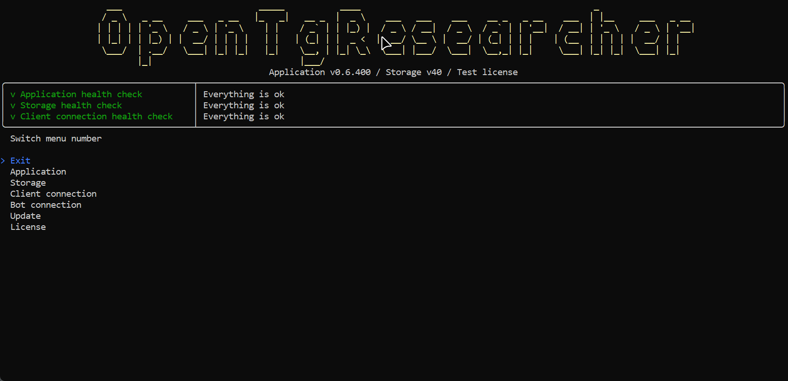
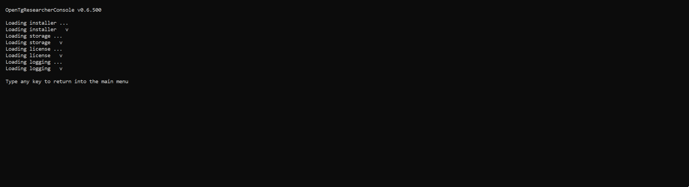

# OpenTgResearcher - инструмент анализа Telegram-чатов и скачивания их содержимого

## Назначение продукта
- Открытый исследователь и поисковик Телеграм
- Скачивай медиа файлы из чатов на свой диск
- Сохраняй сообщения чатов в локальное хранилище
- Просматривай расширенную информацию об участниках чатов
- Просматривай статистику чатов
- Используй как OSINT инструмент
- Используй как парсер инструмент

## Документация
### <div align="center"><b><a href="README.md">Прочти меня</a> | <a href="CHANGELOG.md">Журнал изменений</a> | <a href="RELEASES.md">Статистика скачиваний</a></b></div>
### <div align="center"><b><a href="ARCHITECTURE.md">Архитектура приложения</a> | <a href="TODO.md">Список задач</a></b></div>
### <div align="center"><b><a href="SCREENSHOTS.md">Скриншоты</a> | <a href="Docs/GUIDES-RUS.md">Руководства</a> | <a href="LICENSE.md">Лицензия</a></b></div>

## Скачать
- [Релизы](https://github.com/DamianMorozov/OpenTgResearcher/releases)

## ГитХаб сообщество
- [ГитХаб репозиторий](https://github.com/DamianMorozov/OpenTgResearcher)
- [Сообщить о баге](https://github.com/DamianMorozov/OpenTgResearcher/issues)
- [Обсуждения](https://github.com/DamianMorozov/OpenTgResearcher/discussions)

## Поддержка пользователей
- [OpenTgResearcher группа в ТГ](https://t.me/OpenTgResearcher)

## Докер
- [Докер образ](https://hub.docker.com/repository/docker/damianmorozov/opentgresearcher-console)

## Требования к установке
- Для сборки всех проектов требуется SDK .NET 10 или новее; для запуска сборок без включённой среды выполнения — .NET Runtime 10 и ASP.NET Core Runtime 10
- [Зарегистрируйте Telegram приложение](https://my.telegram.org/apps)
- Сохраните значения полей секции `App configuration`: `App api_id` / `App api_hash`

Проверка целевых платформ проектов, профилей публикации, CI и Docker, затем сборка решения:

```powershell
./Tests/SelfTests/Test-Net10.ps1
dotnet restore OpenTgResearcher.slnx -p:Platform=x64
dotnet build OpenTgResearcher.slnx --no-restore -c Debug -p:Platform=x64 -p:AppxPackageSigningEnabled=false
```

## Локализация при отладке Desktop
При запуске профиля `OpenTgResearcherDesktop (Package)` строки локализации читаются из `%LOCALAPPDATA%\Packages\<PackageFamilyName>\LocalState\Strings`.
До построения локализатора приложение автоматически создаёт папки `en-US` и `ru-RU` и копирует отсутствующие `Resources.resw` из ресурсов пакета.
При повторном запуске существующий файл заменяется, если его размер отличается от файла в пакете; файлы того же размера не перезаписываются.
`<PackageFamilyName>` зависит от идентификатора и издателя пакета.
Ошибки подготовки ресурсов записываются в журнал приложения.
При запуске профиля `OpenTgResearcherDesktop (Unpackaged)` используется каталог `Strings` рядом с исполняемым файлом.

## Управление прокси Desktop
На странице прокси команда «Создать» открывает новую карточку без записи в хранилище. Введите тип, сервер и порт, при необходимости — имя пользователя, пароль и секрет MTProto, затем сохраните запись.
Выбранную строку можно открыть, изменить или удалить; доступны также перезагрузка, сортировка, создание записи без прокси и удаление всех записей с подтверждением.
Удаление прокси сохраняет профили подключения и сбрасывает только ссылки на удаляемые записи. Изменения настроек транспорта применяются при следующем подключении клиента.
Селфтест проверяет исходные модели страниц, SQLite в памяти, HTTP CONNECT и SOCKS5 на локальном тестовом сервере; подключения к Telegram не выполняются:

```powershell
dotnet run --project Tests/SelfTests/Proxies/Proxies.SelfTest.csproj
```

Для явной проверки реального подключения укажите БД и сохранённую сессию. Режим `--live` последовательно проверяет прямое соединение и первую запись с типом, отличным от `None`, в порядке списка страницы (сервер, тип, порт).
Проверка вызывает настоящий `TgConnectClientDesktop`, восстанавливает авторизацию, запрашивает текущего пользователя у Telegram и завершает клиент с проверкой сохранности и освобождения сессии. БД открывается только для чтения; для каждого подключения создаётся отдельная временная копия сессии, которая удаляется после проверки. Если нужен код или пароль, проверка останавливается.

```powershell
dotnet run --project Tests/SelfTests/Proxies/Proxies.SelfTest.csproj -- --live "...TgStorage.db" "$env:LOCALAPPDATA/OpenTgResearcherDesktop/current/OpenTgResearcher.session"
```

## Проверка после обновления пакетов
Совместимость с обновлёнными API Telegram проверяется без сетевого подключения, на SQLite в памяти. Отдельный селфтест проверяет сохранность результатов Rebuild при повторном запросе очистки:

```powershell
dotnet run --project Tests/SelfTests/TelegramCompatibility/TelegramCompatibility.SelfTest.csproj -p:Platform=x64
./Tests/SelfTests/Test-RebuildOutputs.ps1
```

## Проверка запуска Velopack
Desktop и Console вызывают `VelopackApp.Run()` в начале синхронного `Main`, до создания интерфейса, сервисов и хранилища.
Приветствие после первой установки выводится после подготовки приложения. Селфтест читает IL готовых сборок без их запуска: проверяет порядок вызовов, отсутствие повторного запуска Velopack, STA и запуск WinUI в Desktop.
После сборки решения `Debug | x64` выполните из корня решения:

```powershell
$desktopAssembly = 'Presentation/OpenTgResearcherDesktop/bin/Debug_x64/net10.0-windows10.0.19041.0/win-x64/OpenTgResearcherDesktop.dll'
$consoleAssembly = 'Presentation/OpenTgResearcherConsole/bin/Debug_x64/net10.0/OpenTgResearcherConsole.dll'
dotnet run --project Tests/SelfTests/DesktopStartup/DesktopStartup.SelfTest.csproj -p:Platform=x64 --no-build -- --velopack $desktopAssembly $consoleAssembly
```

При упаковке `vpk` должен подтвердить `Verified VelopackApp.Run()` в `Program::Main()` для каждого приложения. Проверка IL и упаковка не заменяют проверку установки и обновления пользователем.

## Проверка закрытия Desktop
При закрытии главного окна Desktop сначала ожидает отключения Telegram и освобождения файла сессии. Авторизация сохраняется для следующего запуска; завершение клиента не выполняет выход из учётной записи.

Для воспроизведения сценария «главная страница → закрытие» в открытой Visual Studio выберите это решение, конфигурацию `Debug | x64` и профиль `OpenTgResearcherDesktop (Package)`. Остановите текущую отладку, затем выполните в PowerShell 7:

```powershell
./Tests/SelfTests/Test-DesktopShutdownVs.ps1 -CloseDelaySeconds 3
```

Селфтест запускает выбранный профиль, нажимает «Продолжить», подтверждает загрузку главной страницы по новым строкам журнала и закрывает окно. Успех требует завершения процесса с кодом 0. При остановке отладчика состояние сохраняется в `Tests/SelfTests/bin/DesktopShutdownVs/break.txt`; неудачный запуск остаётся доступен для диагностики. SHA256 загруженной WinUI выводится в консоль; параметр `-ExpectedXamlSha256` позволяет проверить конкретную DLL. Команда с `-StopFailedRun` завершает активную отладку этого решения.
Отдельная проверка под CDB из Windows SDK не включает инструменты Live Visual Tree:

```powershell
./Tests/SelfTests/Test-DesktopShutdown.ps1 -PackageFullName '<PackageFullName>' -ReadyPattern 'Notification loading|Загрузка уведомлений' -OpenMainPage -CaptureManagedExceptions
```

В дампе одного из сбоев под VS обнаружен стек `RuntimeObject.GetXamlRoot → RemoveRootObjectFromLVT → XamlIsland.Close`; аналогичный сбой описан в [отчёте Microsoft](https://github.com/microsoft/microsoft-ui-xaml/issues/10587). Прохождение CDB не подтверждает устранение этой ошибки под VS. Повторная проверка под VS пока нестабильна; подтверждённого исправления нет.

## Ключевые слова
ОпенТгРесечер, ОпенТгРесёчер, Опен-Тг-Ресечер, Опен-Тг-Ресёчер, Телеграм, скачать, тгскачать, тг-скачать, ресёчер, ресечер, тгресечер, тг-ресечер, тгресёчер, тг-ресёчер

---

## Анимации и скриншоты

### Заставка OpenTgResearcherDesktop
<p align="center"></p>

### Заставка OpenTgResearcherConsole
<p align="center"></p>

### OpenTgResearcherConsole - Мониторинг чатов
<p align="center"></p>

### OpenTgResearcherConsole - Поиск ключевых слов в чатах
<p align="center"></p>
