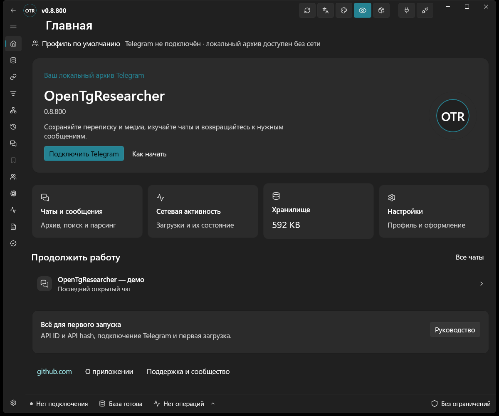
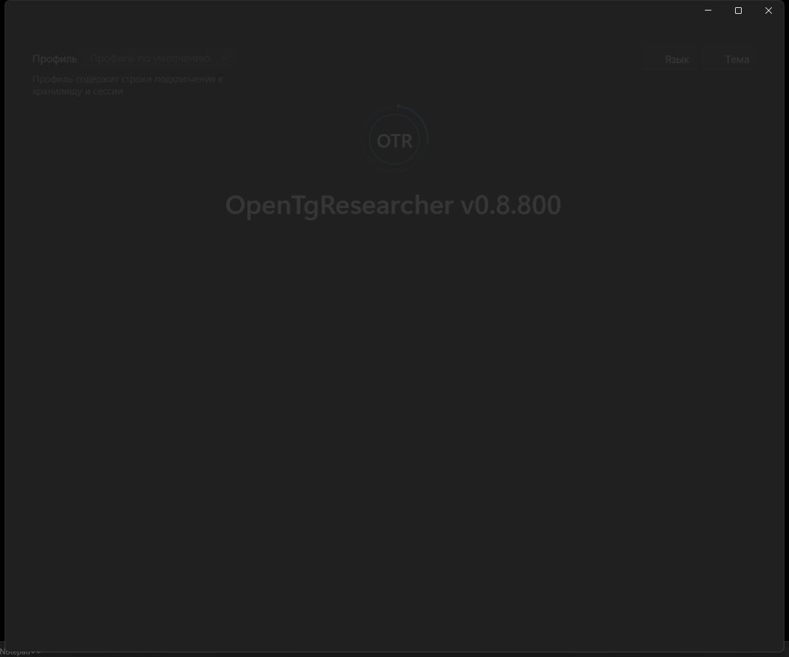

<h1 align="center">OpenTgResearcher</h1>

  <strong>Ваш локальный архив Telegram</strong> 
  Сообщения, медиафайлы и исследование чатов в одном приложении с открытым исходным кодом

  <a href="https://github.com/DamianMorozov/OpenTgResearcher/releases/latest"><strong>Скачать</strong></a> ·
  <a href="#подключение-telegram-и-файл-сессии">Первый запуск</a> ·
  <a href="SCREENSHOTS.md">Скриншоты</a> ·
  <a href="https://t.me/OpenTgResearcher">Поддержка</a>

Desktop для Windows · Console для командной строки · Локальная база SQLite

---

## Назначение продукта

Приложение подключается через ваш аккаунт Telegram и работает с доступными ему чатами, группами и каналами.

- **Сбор сообщений:** сохраняйте тексты и сведения о сообщениях в локальную базу SQLite для дальнейшего просмотра и анализа.
- **Скачивание медиа:** загружайте фотографии, видео, аудио и документы в выбранный каталог, настраивайте фильтры, имена файлов и сохранение обложек.
- **Исследование чатов:** находите нужные чаты в сохранённом списке по ID, имени или названию, просматривайте их описание, содержимое и статистику.
- **Работа с участниками:** просматривайте доступные сведения о пользователях и участниках чата, сопоставляйте их с сохранёнными сообщениями.
- **Повторная обработка:** продолжайте сбор с сохранённой позиции, пропускайте уже загруженные файлы и восстанавливайте файлы нулевого размера.
- **Подключение через прокси:** используйте HTTP, SOCKS5 или MTProto; в Desktop доступны импорт прокси из Telegram Desktop и проверка доступности их серверов.

Продукт подходит для личного архива, исследования сообществ и OSINT-анализа доступных данных Telegram. Для работы доступны графическое приложение Desktop для Windows и консольное приложение Console.

  

Desktop 0.8.800 · Демонстрационные данные · <a href="SCREENSHOTS.md">Все скриншоты</a>

## Документация

| Раздел | Ссылки |
| --- | --- |
| **Начало** | [Руководства](Docs/GUIDES-RUS.md) · [Подключение Telegram](#подключение-telegram-и-файл-сессии) · [Скриншоты](SCREENSHOTS.md) |
| **Проект** | [Журнал изменений](CHANGELOG.md) · [Статистика скачиваний](RELEASES.md) · [Список задач](TODO.md) |
| **Разработка** | [Руководство разработчика](README-DEV.md) · [Архитектура](ARCHITECTURE.md) · [Лицензия](LICENSE.md) |

## Скачать

- [Все релизы](https://github.com/DamianMorozov/OpenTgResearcher/releases)
- [Текущий релиз](https://github.com/DamianMorozov/OpenTgResearcher/releases/latest)

## ГитХаб сообщество

- [ГитХаб репозиторий](https://github.com/DamianMorozov/OpenTgResearcher)
- [Сообщить о баге](https://github.com/DamianMorozov/OpenTgResearcher/issues)
- [Обсуждения](https://github.com/DamianMorozov/OpenTgResearcher/discussions)

## Поддержка пользователей

- [OpenTgResearcher группа в ТГ](https://t.me/OpenTgResearcher)

## Докер

- [Докер образ](https://hub.docker.com/repository/docker/damianmorozov/opentgresearcher-console)

## Требования к установке

- Для запуска сборок без включённой среды выполнения — .NET Runtime 10 и ASP.NET Core Runtime 10
- [Зарегистрируйте Telegram приложение](https://my.telegram.org/apps)
- Сохраните значения полей секции `App configuration`: `App api_id` / `App api_hash`

## Управление прокси Desktop

Если для подключения нужен прокси, откройте страницу «Прокси»:

1. Нажмите «Создать», укажите тип, сервер и порт. При необходимости добавьте логин, пароль или секрет MTProto и сохраните запись.
2. Нажмите «Проверить все прокси», чтобы проверить доступность серверов. Доступный сервер ещё не гарантирует подключение к Telegram.
3. Нажмите на нужную строку правой кнопкой мыши и выберите «Применить прокси». Затем подключитесь к Telegram на странице «Подключение клиента».

Прокси можно импортировать из Telegram Desktop: закройте Telegram, укажите его каталог `tdata` и нажмите «Импорт из Telegram Desktop». После импорта выберите нужный прокси для подключения.

## Подключение Telegram и файл сессии

Для первого входа откройте «Подключение клиента». «Мастер входа» проведёт вас по шагам:

1. Введите API ID и API hash, полученные на [my.telegram.org](https://my.telegram.org/apps).
2. Укажите номер телефона с кодом страны и при необходимости выберите прокси.
3. Введите запрошенный код Telegram и пароль двухэтапной проверки, если она включена.

Для повторного подключения используйте «Центр подключения». Мастер можно снова открыть кнопкой «Мастер входа».

**Файл сессии** сохраняет авторизацию для следующих запусков. Путь к нему задаётся в «Настройки» → «Профиль». Если файл не читается, проверьте API ID, API hash и выбранный файл. Кнопка «Сбросить сессию…» удаляет файл после подтверждения, сохраняя реквизиты подключения. После сброса потребуется войти заново.

**Профиль** объединяет название, базу данных и файл сессии. Создавайте профили для разных аккаунтов в «Настройки» → «Профиль». Выбрать профиль можно там же или на заставке; при смене файлов приложение перезапустится. Удаление профиля в настройках сохраняет его файлы на диске; единственный профиль удалить нельзя.

## Главная страница Desktop

«Центр запуска» показывает текущий профиль и состояние подключения. Отсюда можно подключиться к Telegram, открыть чаты, сетевую активность, хранилище или настройки. Карточка хранилища показывает размер базы данных.

В блоке «Продолжить работу» находятся последние открытые чаты. Внизу страницы доступны руководство первого запуска, сведения о программе и ссылки проекта.

## Работа с чатом

1. Откройте нужный чат на странице «Чаты».
2. Выберите каталог загрузки и настройте сохранение сообщений и файлов.
3. Нажмите «Запустить парсинг чата». Настройки сохранятся автоматически перед запуском.

Скачанные сообщения и медиа доступны во вкладке «Содержимое», сведения об участниках и статистика — в соседних вкладках. После загрузки обновите «Содержимое», чтобы увидеть изменения.

За ходом работы следите на странице «Сетевая активность»: там доступны пауза, продолжение и прерывание парсинга. Можно обрабатывать несколько чатов одновременно. При повторном парсинге программа использует уже скачанные файлы, а пустые загружает заново.

## Верхняя панель и обновление Desktop

Верхняя панель позволяет:

- Обновить текущую страницу.
- Сменить язык и тему — выбор сохраняется сразу.
- Показать или скрыть конфиденциальные данные кнопкой с глазом.
- Открыть раздел обновлений в настройках кнопкой «Обновление».

В настройках доступны «Проверка обновления» и «Проверка предварительного выпуска». Перед установкой предварительного выпуска программа запросит подтверждение.

Автоматическое обновление работает в установленной версии Desktop. После скачивания обновления программа завершит текущие операции и перезапустится. Для проверки обновлений подключение к Telegram не требуется.

## Закрытие Desktop

При закрытии программа останавливает парсинг всех чатов, отключает Telegram и освобождает файл сессии. Авторизация сохраняется: обычное закрытие не выполняет выход из аккаунта.

## Ключевые слова

ОпенТгРесечер, ОпенТгРесёчер, Опен-Тг-Ресечер, Опен-Тг-Ресёчер, Телеграм, скачать, тгскачать, тг-скачать, ресёчер, ресечер, тгресечер, тг-ресечер, тгресёчер, тг-ресёчер

---

## Анимация

Посмотреть анимацию запуска Desktop

