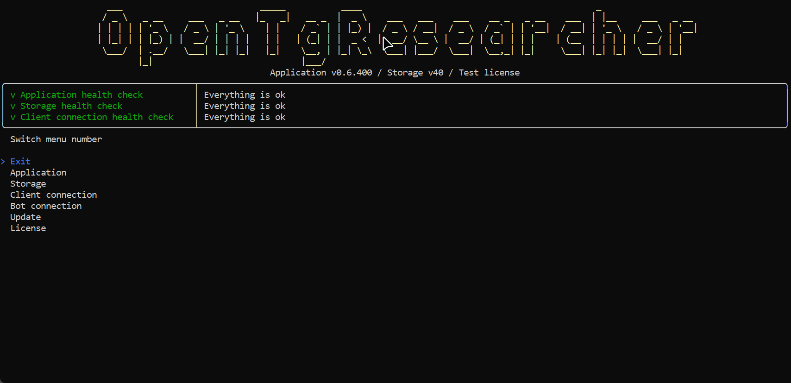
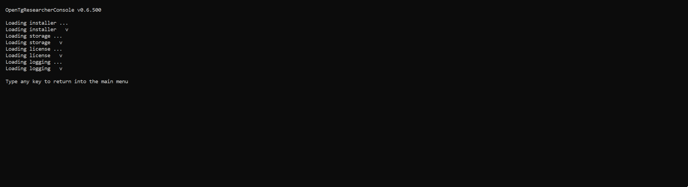

# OpenTgResearcher - инструмент анализа Telegram-чатов и скачивания их содержимого

## Назначение продукта
- Открытый исследователь и поисковик Телеграм
- Скачивай медиа файлы из чатов на свой диск
- Сохраняй сообщения чатов в локальное хранилище
- Просматривай расширенную информацию об участниках чатов
- Просматривай статистику чатов
- Используй как OSINT инструмент
- Используй как парсер инструмент

## Документация
### <div align="center"><b><a href="README.md">Прочти меня</a> | <a href="CHANGELOG.md">Журнал изменений</a> | <a href="RELEASES.md">Статистика скачиваний</a></b></div>
### <div align="center"><b><a href="ARCHITECTURE.md">Архитектура приложения</a> | <a href="TODO.md">Список задач</a></b></div>
### <div align="center"><b><a href="SCREENSHOTS.md">Скриншоты</a> | <a href="Docs/GUIDES-RUS.md">Руководства</a> | <a href="LICENSE.md">Лицензия</a></b></div>

## Скачать
- [Релизы](https://github.com/DamianMorozov/OpenTgResearcher/releases)

## ГитХаб сообщество
- [ГитХаб репозиторий](https://github.com/DamianMorozov/OpenTgResearcher)
- [Сообщить о баге](https://github.com/DamianMorozov/OpenTgResearcher/issues)
- [Обсуждения](https://github.com/DamianMorozov/OpenTgResearcher/discussions)

## Поддержка пользователей
- [OpenTgResearcher группа в ТГ](https://t.me/OpenTgResearcher)

## Докер
- [Докер образ](https://hub.docker.com/repository/docker/damianmorozov/opentgresearcher-console)

## Требования к установке
- Для сборки всех проектов требуется SDK .NET 10 или новее; для запуска сборок без включённой среды выполнения — .NET Runtime 10 и ASP.NET Core Runtime 10
- [Зарегистрируйте Telegram приложение](https://my.telegram.org/apps)
- Сохраните значения полей секции `App configuration`: `App api_id` / `App api_hash`

Проверка целевых платформ проектов, профилей публикации, CI и Docker, затем сборка решения:

```powershell
./Tests/SelfTests/Test-Net10.ps1
dotnet restore OpenTgResearcher.slnx -p:Platform=x64
dotnet build OpenTgResearcher.slnx --no-restore -c Debug -p:Platform=x64 -p:AppxPackageSigningEnabled=false
```

## Локализация при отладке Desktop
При запуске профиля `OpenTgResearcherDesktop (Package)` строки локализации читаются из `%LOCALAPPDATA%\Packages\<PackageFamilyName>\LocalState\Strings`.
До построения локализатора приложение автоматически создаёт папки `en-US` и `ru-RU` и копирует отсутствующие `Resources.resw` из ресурсов пакета.
При повторном запуске существующий файл заменяется, если его размер отличается от файла в пакете; файлы того же размера не перезаписываются.
`<PackageFamilyName>` зависит от идентификатора и издателя пакета.
Ошибки подготовки ресурсов записываются в журнал приложения.
При запуске профиля `OpenTgResearcherDesktop (Unpackaged)` используется каталог `Strings` рядом с исполняемым файлом.

## Управление прокси Desktop
На странице прокси команда «Создать» открывает новую карточку без записи в хранилище. Введите тип, сервер и порт, при необходимости — имя пользователя, пароль и секрет MTProto, затем сохраните запись.
Выбранную строку можно открыть, изменить или удалить; доступны также перезагрузка, сортировка, создание записи без прокси и удаление всех записей с подтверждением.
Удаление прокси сохраняет профили подключения и сбрасывает только ссылки на удаляемые записи. Изменения настроек транспорта применяются при следующем подключении клиента.
Колонка «Доступность TCP» показывает результат команды «Проверить все прокси»: доступность сервера и порта и время TCP-подключения. Ожидание ограничено 5 секундами на запись; запись «Без прокси» пропускается.
Эта проверка не проверяет авторизацию на прокси и доступ к Telegram, не меняет активное подключение. Результаты действуют для текущего списка и сбрасываются при его перезагрузке.
Чтобы применить запись, нажмите на строку правой кнопкой мыши и выберите «Применить прокси». Откроется «Подключение клиента» с выбранной записью, для существующего профиля выбор сохраняется сразу.
Для нового профиля сначала заполните API ID, API hash и телефон, затем сохраните настройки. Само применение прокси не запускает подключение к Telegram.

Для импорта из установленного Telegram Desktop закройте Telegram, укажите каталог `tdata` на странице прокси и нажмите «Импорт из Telegram Desktop».
По умолчанию указан `%APPDATA%\Telegram Desktop\tdata`; для портативной или другой установки замените путь каталогом своего клиента. Можно указать и родительский каталог, содержащий `tdata`.
Переменные окружения в пути раскрываются, кавычки из проводника допускаются. Сначала проверяются файлы выбранного каталога, затем вложенный `tdata`.
Если файл не найден, сообщение показывает проверенный каталог; при блокировке или отказе доступа предлагается закрыть Telegram и проверить права на чтение.
После подтверждения импортируются сохранённые SOCKS5, HTTP и MTProto-прокси, включая реквизиты и секрет MTProto. Совпадающие тип, адрес без учёта регистра и порт пропускаются без изменения существующих записей.
Web-прокси пропускаются, остальные записи импортируются. Результат отдельно показывает количество добавленных прокси, совпадений и пропущенных Web-прокси.
Импорт выполняется одной транзакцией; ошибка записи откатывает весь импорт. После завершения список обновляется.
Импорт не выбирает прокси для текущего подключения: нужную запись выберите на странице «Подключение клиента» перед следующим подключением.
Читаются только общие настройки `settingss` или резервные `settings0`/`settings1`; файлы Telegram и данные авторизации не изменяются, пароль аккаунта не требуется.
Поддерживается формат блока `Core::Settings` со списком `Core::SettingsProxy`. Старые и неизвестные форматы, неизвестные типы прокси и повреждённые файлы отклоняются с сообщением; проверьте путь и версию Telegram Desktop.
Порядок полей и шифрование сверены с исходниками Telegram Desktop:
[контейнер настроек](https://github.com/telegramdesktop/tdesktop/blob/5ff615713d2178b8458e201778d23d7abe78db9b/Telegram/SourceFiles/storage/details/storage_file_utilities.cpp),
[настройки приложения](https://github.com/telegramdesktop/tdesktop/blob/5ff615713d2178b8458e201778d23d7abe78db9b/Telegram/SourceFiles/core/core_settings.cpp),
[список прокси](https://github.com/telegramdesktop/tdesktop/blob/5ff615713d2178b8458e201778d23d7abe78db9b/Telegram/SourceFiles/core/core_settings_proxy.cpp).

Селфтест проверяет исходные модели страниц, SQLite в памяти, импорт синтетических зашифрованных настроек, HTTP CONNECT и SOCKS5 на локальном сервере; подключения к Telegram не выполняются:

```powershell
dotnet run --project Tests/SelfTests/Proxies/Proxies.SelfTest.csproj
```

Открытие страницы и локализацию заголовков проверяет отдельный селфтест настоящего окна Desktop. Перед запуском закройте Desktop и укажите путь к опубликованному unpackaged-приложению.
Тест создаёт отдельные настройки и БД, открывает страницу «Прокси», проверяет шесть заголовков и отсутствие необработанных исключений в журнале, затем закрывает приложение с проверкой кода выхода. Подключение к Telegram не выполняется.

```powershell
./Tests/SelfTests/Test-DesktopProxies.ps1 -ExecutablePath '.../OpenTgResearcher/Releases/Desktop-x64/OpenTgResearcherDesktop.exe' -Language Russian
./Tests/SelfTests/Test-DesktopProxies.ps1 -ExecutablePath '.../OpenTgResearcher/Releases/Desktop-x64/OpenTgResearcherDesktop.exe' -Language English
```

Для явной проверки реального подключения укажите БД и сохранённую сессию. Режим `--live` последовательно проверяет прямое соединение и первую запись с типом, отличным от `None`, в порядке списка страницы (сервер, тип, порт).
Проверка вызывает настоящий `TgConnectClientDesktop`, восстанавливает авторизацию, запрашивает текущего пользователя у Telegram и завершает клиент с проверкой сохранности и освобождения сессии. БД открывается только для чтения; для каждого подключения создаётся отдельная временная копия сессии, которая удаляется после проверки. Если нужен код или пароль, проверка останавливается.

```powershell
dotnet run --project Tests/SelfTests/Proxies/Proxies.SelfTest.csproj -- --live "...TgStorage.db" "$env:LOCALAPPDATA/OpenTgResearcherDesktop/current/OpenTgResearcher.session"
```

Ошибки API ID / API hash объясняются на странице «Подключение клиента»: параметры приложения берутся в [API development tools](https://my.telegram.org/apps),
а при наличии прежнего профиля выбирается его БД в «Настройки» → «Файлы» → «Хранилище» с сохранением настроек и перезапуском Desktop.
Файл сессии должен соответствовать выбранной паре API ID / API hash. Ошибка `Exception while reading session file` возникает до подключения к Telegram.
В «Настройки» → «Файлы» → «Сессия» укажите подходящий прежний файл или новый, ещё не существующий путь в отдельном каталоге данных и сохраните настройки.
Для новой сессии потребуется вход с кодом Telegram и, если включён, паролем двухэтапной проверки.
Кнопка «Сбросить сессию» после подтверждения отключает клиента и удаляет выбранный файл сессии, сохраняя API-параметры, телефон и выбранный прокси.
Затем нажмите «Подключить Telegram» для нового входа. Кнопка «Удалить» после подтверждения удаляет и профиль из БД, и файл сессии.
Без подтверждённого сброса или удаления приложение сохраняет прежний файл и не повторяет его чтение после ошибки без изменения настроек.

Расшифровку сессии можно проверить отдельно без сети: БД открывается только для чтения, временная копия проверяется штатным файловым хранилищем WTelegram, реквизиты не выводятся.
Успех этой проверки подтверждает чтение файла; действительность авторизации проверяется отдельным режимом `--live`.

```powershell
dotnet run --project Tests/SelfTests/ClientConnection/ClientConnection.SelfTest.csproj -p:Platform=x64 -- --inspect-session "...TgStorage.db" "...OpenTgResearcher.session"
```

## Проверка страницы чата
Настройки и загрузка используют общий черновик: переключение вкладок сохраняет введённые значения до команды сохранения. Участники, сведения и статистика сбрасываются при открытии другого чата.
Селфтест проверяет исходные модели всех восьми страниц чата, обработчик выбора вкладок, разметку, сохранение и пагинацию на настоящих репозиториях с SQLite в памяти. Telegram заменён тестовым клиентом:

```powershell
dotnet run --project Tests/SelfTests/Chat/Chat.SelfTest.csproj -c Debug -p:Platform=x64
```

Для проверки настоящего окна закройте Desktop и укажите опубликованное unpackaged-приложение. Скрипт создаёт отдельные настройки, БД и путь сессии, открывает чат, последовательно посещает семь вкладок и проверяет журнал и код завершения:

```powershell
$desktop = '.../OpenTgResearcher/Releases/Desktop-x64/OpenTgResearcherDesktop.exe'
$chatTest = 'Tests/SelfTests/Chat/bin/Debug_x64/net10.0/Chat.SelfTest.dll'
./Tests/SelfTests/Test-DesktopChat.ps1 -ExecutablePath $desktop -SelfTestAssembly $chatTest -Language Russian
./Tests/SelfTests/Test-DesktopChat.ps1 -ExecutablePath $desktop -SelfTestAssembly $chatTest -Language English
```

Без дополнительных параметров создаётся синтетический чат. Параметры `-SourceDatabase`, `-ChatId` и `-ChatDirectory` позволяют проверить выбранный чат из существующей БД:
источник открывается только для чтения, в тестовую БД копируются выбранный чат, до 100 последних сообщений и связанные пользователи. Реквизиты подключения и сессии не копируются.
Результаты сохраняются в `Tests/SelfTests/bin/ChatPage`. Скрипт проверяет открытие и навигацию без Telegram, сохранение обоих состояний автообновления через диалог и перечитывание SQLite.
При выборе существующей БД также проверяется получение авторов сообщений в таблицу участников; изменяется только тестовая выборка. Настройки должны показывать выбранный чат уже при первом открытии.
Параметр `-CheckMediaPreview` проверяет синтетический чат с настоящей JPEG-обложкой: находит видимый элемент `Image`, проверяет отрисованный цвет и сохраняет снимок области обложки. Этот режим запускается без `-SourceDatabase`.
Он также проверяет скрытие обложки переключателем конфиденциальных данных и отображение подсказки пустого списка после подтверждённой очистки тестовой выборки.
Параметр `-WindowWidth 1280` задаёт ширину тестового окна. Проверяются девять локализованных заголовков, доступная ширина фильтра, границы кнопок и выбор раздела «Чаты»; снимки страниц сохраняются рядом с журналом.
Селфтесты чата также проверяют медиафайлы в отдельных временных каталогах: настоящий обработчик выбирает файл и открывает поток, подменяется только передача байтов из Telegram.
Нулевые документы, фотографии и обложки загружаются заново независимо от разрешения перезаписи. Непустой файл меньшего размера заменяется только при включённой перезаписи файлов.
При включённом присоединении ID готовый файл без ID переименовывается только при совпадении исходного имени и размера из Telegram; повторное скачивание не выполняется, существующая обложка переносится вместе с ним.
Вкладка «Содержимое» ищет обложку с именем основного файла и расширением `.thumb.jpg`, включая исторические варианты с ID и без ID. После загрузки файлов обновите вкладку, чтобы перечитать содержимое.
Остановка парсинга прерывает ожидание FLOOD_WAIT; цикл сохраняет токен своего запуска и ожидает очередь перед завершением. Отменённый проход не отмечается обработанным до конца чата.
Для ограниченной сетевой проверки готовых документов используется отдельная команда:

```powershell
dotnet $chatTest --live-media '.../TgStorage.db' '.../OpenTgResearcher.session' ID '.../dir'
```

Проверка восстанавливает существующую авторизацию из временной копии сессии, читает метаданные двадцати документов и дважды вызывает настоящий обработчик пропуска готовых файлов.
Исходная БД открывается только для чтения, готовые файлы блокируются от записи, скачивание запрещено. Новые коды и пароли не запрашиваются; временная сессия удаляется после отключения.
Этот режим проверяет пропуск существующих документов; полный парсинг архива и восстановление отсутствующих файлов он не запускает.

Для ограниченной проверки парсинга и настоящей передачи файлов используется отдельный режим:

```powershell
dotnet $chatTest --live-chat '.../TgStorage.db' '.../OpenTgResearcher.session' ID
```

Он читает каталог выбранного чата из БД, восстанавливает авторизацию из копии сессии и разбирает последние несколько сообщений в отдельную SQLite в памяти.
Затем закрывает TCP только тестового клиента, проверяет восстановление авторизованного запроса и повторный разбор без дубликатов.
Из последних ста сообщений выбираются до двух документов размером до 1 МиБ, скачиваются в созданный тестом подкаталог каталога чата и проверяются по размеру.
После отключения тест удаляет только этот подкаталог и копию сессии. Исходные БД, сессия и готовые файлы не изменяются; полный архив не обрабатывается.
Если авторизация недействительна, каталог недоступен или подходящих документов нет, проверка завершается с ошибкой и сохраняет журнал.

## Проверка страницы обновлений Desktop
В верхней панели доступны выбор языка, выбор системной, светлой или тёмной темы, переключатель конфиденциальных данных и проверка стабильных обновлений. Язык и тема применяются и сохраняются сразу, отдельно от остальных настроек. Переключатель «Данные» показывает или скрывает конфиденциальные поля на всех страницах и сохраняет выбранное состояние при навигации в текущем запуске, без обращения к БД и Telegram. В узком окне остаются компактные элементы с подсказками; при увеличении ширины появляются подписи. Проверка открывает страницу обновлений и использует её общий журнал и подтверждение.
Кнопка настроек, подписи страницы обновлений и её журнал используют выбранный язык приложения: русский или английский. Проверка GitHub не требует подключения к Telegram.
В установленной через Velopack версии страница скачивает и подготавливает пакет, показывает прогресс и поддерживает отмену скачивания. После завершения закройте приложение штатно и запустите снова: ранний вызов Velopack применит подготовленное обновление.
В Visual Studio и обычном каталоге публикации вместо сетевого запроса показывается инструкция установки. При отмене уже начатой проверки GitHub ответ ожидается до завершения запроса, после чего скачивание не начинается.
Селфтесты используют исходные VM и службу навигации, настоящие ресурсы обоих языков и подменённый источник пакетов:

```powershell
dotnet run --project Tests/SelfTests/Updates/Updates.SelfTest.csproj -c Debug -p:Platform=x64
```

Проверка опубликованного окна использует отдельные настройки и тестовую БД, проверяет подпись настроек, переход на страницу, подтверждения и доступность журнала:

```powershell
./Tests/SelfTests/Test-DesktopUpdates.ps1 -ExecutablePath '.../OpenTgResearcherDesktop.exe' -Language Russian
./Tests/SelfTests/Test-DesktopUpdates.ps1 -ExecutablePath '.../OpenTgResearcherDesktop.exe' -Language English
```

Параметр `-Toolbar` дополнительно проверяет элементы верхней панели настоящими нажатиями мыши, переключение языка и темы, сохранение выбора и геометрию при ширине окна 800 и 1280. Для конфиденциальных данных проверяются оба состояния, скрытие поля пути тестовой БД в настройках и сохранение состояния при переходах между страницами без подключения Telegram.

Эти проверки не устанавливают новую версию и не подтверждают обновление установленного приложения через GitHub; полный переход между выпусками проверяется отдельно в пользовательском контуре.

## Проверка после обновления пакетов
Общая версия всех проектов задаётся свойством `Version` в [Directory.Build.props](Directory.Build.props). Версии сборок и файлов вычисляются SDK; наследование в Debug и Release проверяет команда `./Tests/SelfTests/Test-ProjectVersion.ps1`.
Совместимость с обновлёнными API Telegram проверяется без сетевого подключения, на SQLite в памяти. Отдельный селфтест проверяет сохранность результатов Rebuild при повторном запросе очистки:

```powershell
dotnet run --project Tests/SelfTests/TelegramCompatibility/TelegramCompatibility.SelfTest.csproj -p:Platform=x64
./Tests/SelfTests/Test-RebuildOutputs.ps1
```

## Проверка запуска Velopack
Desktop и Console вызывают `VelopackApp.Run()` в начале синхронного `Main`, до создания интерфейса, сервисов и хранилища.
Приветствие после первой установки выводится после подготовки приложения. Селфтест читает IL готовых сборок без их запуска: проверяет порядок вызовов, отсутствие повторного запуска Velopack, STA и запуск WinUI в Desktop.
После сборки решения `Debug | x64` выполните из корня решения:

```powershell
$desktopAssembly = 'Presentation/OpenTgResearcherDesktop/bin/Debug_x64/net10.0-windows10.0.19041.0/win-x64/OpenTgResearcherDesktop.dll'
$consoleAssembly = 'Presentation/OpenTgResearcherConsole/bin/Debug_x64/net10.0/OpenTgResearcherConsole.dll'
dotnet run --project Tests/SelfTests/DesktopStartup/DesktopStartup.SelfTest.csproj -p:Platform=x64 --no-build -- --velopack $desktopAssembly $consoleAssembly
```

При упаковке `vpk` должен подтвердить `Verified VelopackApp.Run()` в `Program::Main()` для каждого приложения. Проверка IL и упаковка не заменяют проверку установки и обновления пользователем.

Для проверки опубликованного Desktop без MSIX выполните в PowerShell из корня решения:

```powershell
./Tests/SelfTests/Test-DesktopReleaseStartup.ps1 -ExecutablePath '.../OpenTgResearcher/Releases/Desktop-x64/OpenTgResearcherDesktop.exe' -Language Russian
./Tests/SelfTests/Test-DesktopReleaseStartup.ps1 -ExecutablePath '.../OpenTgResearcher/Releases/Desktop-x64/OpenTgResearcherDesktop.exe' -Language English
```

Перед проверкой закройте Desktop. Каждый запуск использует отдельные настройки, БД и путь сессии в `Tests/SelfTests/bin/ReleaseStartup`; подключения к Telegram нет.
Проверка требует сохранения языка после загрузки заставки, продолжения работы процесса и штатного закрытия с кодом 0. Она воспроизводит вылет UWP `ResourceContext` в Release без MSIX, который не обнаруживается одной сборкой и упаковкой.

## Проверка закрытия Desktop
При закрытии главного окна Desktop сначала ожидает отключения Telegram и освобождения файла сессии. Авторизация сохраняется для следующего запуска; завершение клиента не выполняет выход из учётной записи.

Для воспроизведения сценария «главная страница → закрытие» в открытой Visual Studio выберите это решение, конфигурацию `Debug | x64` и профиль `OpenTgResearcherDesktop (Package)`. Остановите текущую отладку, затем выполните в PowerShell 7:

```powershell
./Tests/SelfTests/Test-DesktopShutdownVs.ps1 -CloseDelaySeconds 3
```

Селфтест запускает выбранный профиль, нажимает «Продолжить», подтверждает загрузку главной страницы по новым строкам журнала и закрывает окно. Успех требует завершения процесса с кодом 0. При остановке отладчика состояние сохраняется в `Tests/SelfTests/bin/DesktopShutdownVs/break.txt`; неудачный запуск остаётся доступен для диагностики. SHA256 загруженной WinUI выводится в консоль; параметр `-ExpectedXamlSha256` позволяет проверить конкретную DLL. Команда с `-StopFailedRun` завершает активную отладку этого решения.
Отдельная проверка под CDB из Windows SDK не включает инструменты Live Visual Tree:

```powershell
./Tests/SelfTests/Test-DesktopShutdown.ps1 -PackageFullName '<PackageFullName>' -ReadyPattern 'Notification loading|Загрузка уведомлений' -OpenMainPage -CaptureManagedExceptions
```

В дампе одного из сбоев под VS обнаружен стек `RuntimeObject.GetXamlRoot → RemoveRootObjectFromLVT → XamlIsland.Close`; аналогичный сбой описан в [отчёте Microsoft](https://github.com/microsoft/microsoft-ui-xaml/issues/10587). Прохождение CDB не подтверждает устранение этой ошибки под VS. Повторная проверка под VS пока нестабильна; подтверждённого исправления нет.

## Ключевые слова
ОпенТгРесечер, ОпенТгРесёчер, Опен-Тг-Ресечер, Опен-Тг-Ресёчер, Телеграм, скачать, тгскачать, тг-скачать, ресёчер, ресечер, тгресечер, тг-ресечер, тгресёчер, тг-ресёчер

---

## Анимации и скриншоты

### Заставка OpenTgResearcherDesktop
<p align="center"></p>

### Заставка OpenTgResearcherConsole
<p align="center"></p>

### OpenTgResearcherConsole - Мониторинг чатов
<p align="center"></p>

### OpenTgResearcherConsole - Поиск ключевых слов в чатах
<p align="center"></p>
